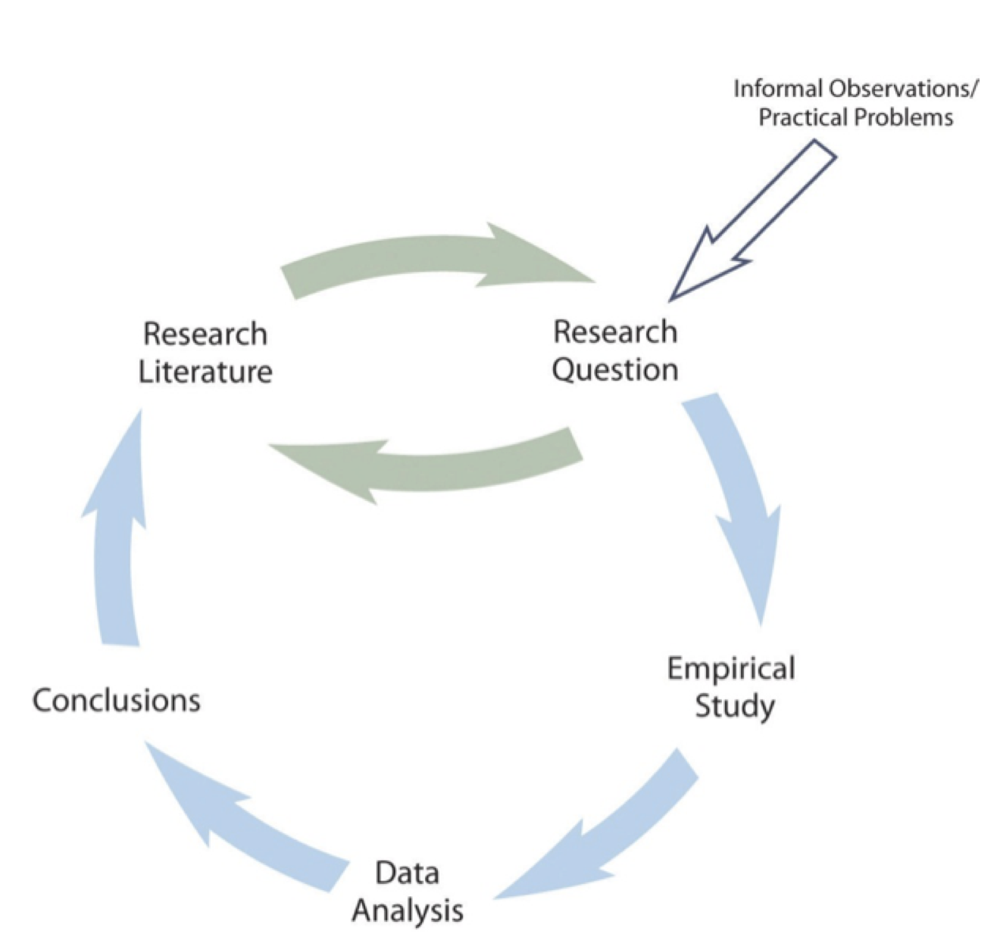
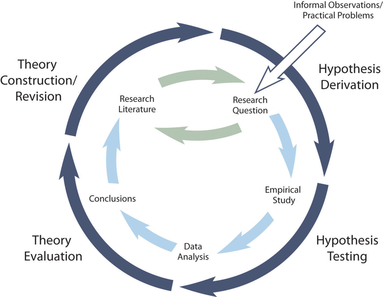

# Psychological Science

Many people believe that women tend to talk more than men—with some even suggesting that this difference has a biological basis. One widely cited estimate is that women speak 20,000 words per day on average and men speak only 7,000. This claim seems plausible, but is it true? A group of psychologists led by Matthias Mehl decided to find out. They checked to see if anyone had actually tried to count the daily number of words spoken by women and men. No one had. So these researchers conducted a study in which female and male college students (369 in all) wore audio recorders while they went about their lives. The result? The women spoke an average of 16,215 words per day and the men spoke an average of 15,669—an extremely small difference that could easily be explained by chance. In an article in the journal Science, these researchers summed up their findings as follows: “We therefore conclude, on the basis of available empirical evidence, that the widespread and highly publicized stereotype about female talkativeness is unfounded”[@mehl_are_2007, p.82].

<!-- YS edit 20260511 -->
Psychological science is a process for asking and answering questions about human behavior and mental processes. But why _science_? Does scientific psychology tell us anything that common sense does not? Why should I bother to learn the scientific approach—especially if I want to be a clinical psychologist and not a researcher? These are extremely good questions, and answering them now will provide a solid foundation for learning the rest of the material in your course.

In this chapter, we first examine common ways people form beliefs and acquire knowledge, then explore what makes scientific knowledge distinctive. We look closely at the key features and goals of science, explain why psychologists use the scientific method, and introduce the process of using the scientific method to ask and answer questions relevant to psychologists. 

## Ways of Knowing

<!-- YS edit 20260511 -->
Take a minute to ponder some of your beliefs and how you acquired those beliefs. Perhaps you believe that your friend is lying to you because she is acting strange and won’t look you in the eye; perhaps you believe that you should make your bed in the morning because your mother or father told you this is what you should do; perhaps you believe that swans are white because all of the swans you have seen are white; perhaps you believe that women are more talkative than men because women tend to talk more than men in your family. But can you *know* whether these beliefs match reality? Can you trust these sources? Before we examine how science works, we will first explore common ways people come to "know" things, each with its strengths and weaknesses. 

### Learning Objectives {.unnumbered}

1. Describe the five ways of knowing and their strengths and weaknesses.
2. Explain why science is a powerful method for answering questions about the empirical world.

### Intuition

The first way of knowing is intuition. When we use our intuition, we are relying on our guts, our emotions, and/or our instincts to guide us. Rather than examining facts or using rational thought, intuition involves believing what *feels* true. The problem with relying on intuition is that our intuitions can be wrong because they are driven by cognitive and motivational biases rather than logical reasoning or scientific evidence. <!--YS edit 20260722--> There are many biases, including confirmation bias, where we tend to focus on evidence that is consistent with our point of view, and present bias, where we fail to consider what we cannot see or what is not immediately present. Intuition is also influenced by what comes to mind more easily, which is known as the availability heuristic. For example, if you have recently read about a friend who was caught lying, "lying" is more available in your mind and thus you may be more likely to believe that your friend is acting strangely because they are lying to you. But in reality, it may just be that s/he is holding in a bit of gas or is preoccupied with some other issue that is irrelevant to you. 
However, weighing alternatives and thinking of all the different possibilities can be paralyzing for some people and sometimes decisions based on intuition are actually superior to those based on analysis (people interested in this idea should read Blink by Malcolm @gladwell2005).

### Authority

Perhaps one of the most common ways of acquiring knowledge is through authority. This method involves accepting new ideas because some authority figure states that they are true. These authorities include parents, the media, doctors, religious authorities, the government, and professors. While in an ideal world we should be able to trust authority figures, history has taught us otherwise and many instances of atrocities against humanity are a consequence of people unquestioningly following authority. 
<!-- TODO: Korean Fan death? -->
On a more benign level, while your parents may have told you that you should make your bed in the morning, making your bed provides the warm damp environment in which mites thrive. Keeping the sheets open provides a less hospitable environment for mites. These examples illustrate that the problem with using authority to obtain knowledge is that they may be wrong, they may just be using their intuition to arrive at their conclusions, and they may have their own reasons to mislead you. Nevertheless, much of the information we acquire is through authority because we don’t have time to question and independently research every piece of knowledge we learn through authority. But we can learn to evaluate the credentials of authority figures, to evaluate the methods they used to arrive at their conclusions, and evaluate whether they have any reasons to mislead us.

### Rationalism

Rationalism involves using logic and reasoning to acquire new knowledge. There are two types of reasoning that are commonly used: **deductive reasoning** and **inductive reasoning**. Deductive reasoning involves starting with a general principle or premise and using logic to arrive at a specific conclusion. Premises are stated and logical rules are followed to arrive at sound conclusions. For instance, if I am given the premise that all swans are white and the premise that this is a swan then I can come to the rational conclusion that this swan is white without actually seeing the swan. However, the **soundness** of the conclusion hinges on not only the **validity** of logical steps but also the truth of the premises. For instance, the premise that all swans are white is incorrect; there are black swans in Australia. Thus, the conclusion drawn from the premisses will not be sound. In addition, it's important to acknowledge that valid logical reasoning is difficult and that there are many fallacies in human logical reasoning. Nevertheless, if the premises are correct and logical rules are followed appropriately then this is a sound means of acquiring knowledge.

<!-- TODO: add sound and valid reasoning -->
<!-- YS edit 20260722 -->
Rationalism also involves **inductive reasoning**, where we draw general conclusions from specific observations. For example, if I observe that all the swans I have seen are white, I may generalize that swans are white. How much you can generalize from your observations depends on how many observations you have made and how representative those observations are of the population (all swans in the world or just swans in your area?). You can't be drawing conclusions about all swans from just one or two swans you have seen, and you can't generalize your observation from your area to Australia where black swans are found. If used carefully, inductive reasoning can be a powerful tool for acquiring knowledge, and it is the basis of inferential statistics where we make inferences about some population based on a sample of that population. 

### Empiricism

Empiricism involves acquiring knowledge through observation and experience. Once again many of you may have believed that all swans are white because you have only ever seen white swans. For centuries people believed the world is flat because it appears to be flat. These examples and the many visual illusions that trick our senses illustrate the problems with relying on empiricism alone to derive knowledge. We are limited in what we can experience and observe and our senses can deceive us. Moreover, our prior experiences can alter the way we perceive events. 

Even extensive experience may not expose us to the full range of possibilities, and our everyday observations often fail to account for alternative explanations. For example, you may think your friend is lying because they are acting strangely, but their behavior might actually be explained by an unrelated factor—perhaps they recently broke up with someone and you happen to see them only when that person is nearby. This uncontrolled factor (the ex's presence) confounds your observations and leads you to an incorrect conclusion. Ruling out such alternative explanations is a key part of the scientific method, and this is often difficult to do with casual observation alone. 

Nevertheless, empiricism is at the heart of the scientific method. Science relies on observations. But not just any observations, science relies on _structured_ observations which is known as systematic empiricism.

### The Scientific Method

The scientific method is a process of systematically collecting and evaluating evidence to test ideas and answer questions. While scientists may use intuition, authority, rationalism, and empiricism to generate new ideas, they don’t stop there. Scientists go a step further by making careful observations under various controlled conditions in order to test their ideas, and they use rationalism to arrive at valid conclusions. In the next section, we will examine the defining features that make science our powerful method for answering questions about the empirical world.

### Key Takeaways {.unnumbered}

- Ways of knowing include intuition, authority, rationalism, empiricism, and the scientific method, each with its strengths and weaknesses.

### Exercises {.unnumbered}

1. **Practice**: In each of the following scenarios, which way of knowing is being used? Is the conclusion sound and valid? Why or why not?
   a. 
      > - "All humans are immortal." (Premise 1) 
      > - "Socrates is a human." (Premise 2) 
      > - "Therefore, Socrates is immortal." (Conclusion)

    a. You logged your mood for 4 weeks as you do yoga and drink protein shakes every morning. Your data show that your mood is better than it was before you started this routine. You conclude that yoga and protein shakes improve your mood.

1. **Discussion**: What is your question about human psychology that you would like to answer? Discuss how each way of knowing could be used to answer your question and the strengths and weaknesses of each approach. 

## Understanding Science

We've explored five ways people acquire beliefs about the world. But why do psychologists specifically rely on the scientific method? To answer this question, we need to understand what science is, what makes psychology a science, and what the scientific approach allows us to accomplish.

### Learning Objectives {.unnumbered}

1.  Define science and explain why psychology is a science.
2.  Describe the three fundamental features of science.
3.  Determine whether a question can be answered scientifically
4.  Describe the three goals of science.
5.  Explain the limitations of common sense for understanding human behavior
6.  Define pseudoscience and give some examples.

### Is Psychology a Science?

Some people are surprised to learn that psychology is a science. They generally agree that astronomy, biology, and chemistry are sciences but wonder what psychology has in common with these other fields. Before answering this question, however, it is worth reflecting on what astronomy, biology, and chemistry have in common with each other. It is clearly not their subject matter. Astronomers study celestial bodies, biologists study living organisms, and chemists study matter and its properties. It is also not the equipment and techniques that they use. Few biologists would know what to do with a radio telescope, for example, and few chemists would know how to track a moose population in the wild. For these and other reasons, philosophers and scientists who have thought deeply about this question have concluded that what the sciences have in common is a general approach to understanding the natural world. Psychology is a science because it takes this _same general approach_ to understanding one aspect of the natural world: human behavior. But what exactly does this "general approach" involve? 


### Features of Science

The general scientific approach has three fundamental features [@stanovich_how_2013]. The first is **systematic empiricism**. Empiricism refers to learning based on observation, and scientists learn about the natural world systematically, by carefully planning, making, recording, and analyzing observations of it. As we will see, logical reasoning and even creativity play important roles in science too, but scientists are unique in their insistence on checking their ideas about the way the world is against their systematic observations. Notice, for example, that Mehl and his colleagues did not trust other people’s stereotypes or even their own informal observations. Instead, they systematically recorded, counted, and compared the number of words spoken by a large sample of women and men. Furthermore, when their systematic observations turned out to conflict with people’s stereotypes, they trusted their systematic observations.

The second feature of the scientific approach—which follows in a straightforward way from the first—is that it is concerned with **empirical questions**. Empirical questions are questions that can be answered by observations. These are questions about the way the world actually is and, therefore, can be answered by systematically observing it. The question of whether women talk more than men is empirical in this way. Either women really do talk more than men or they do not, and this can be determined by systematically observing how much women and men actually talk. <!--YS edit 20260616-->Either of these two possible answers to the question is **falsifiable** when the empirical evidence points to the other direction. But there are many interesting and important questions about the world that are not empirically testable, and thus science is not in a position to answer. Among these are questions about values—whether things are good or bad, just or unjust, or beautiful or ugly, and how the world *ought* to be. So, although the question of whether a stereotype is accurate or inaccurate is an empirically testable one that science can answer, the question—or, rather, the value judgment—of whether it is wrong for people to hold inaccurate stereotypes is not. Similarly, the question of whether criminal behavior has a genetic basis is an empirical question, but the question of what actions ought to be considered illegal is not. It is especially important for researchers in psychology to be mindful of this distinction.

The third feature of science is that it creates **public knowledge**. After asking their empirical questions, making their systematic observations, and drawing their conclusions, scientists publish their work. This usually means writing an article for publication in a professional journal, where they put their research question in the context of previous research, describe in detail the methods they used to answer their question, and clearly present their results and conclusions. Increasingly, scientists are opting to publish their work in open access journals so the articles are freely available to all – scientists and nonscientists alike. This important choice allows publicly-funded research to create knowledge that is truly public.

Publication is an essential feature of science for two reasons. One is that science is a social process—a large-scale collaboration among many researchers distributed across both time and space. Our current scientific knowledge of most topics is based on many different studies conducted by many different researchers who have shared their work publicly over many years. The second is that publication allows science to be self-correcting. Individual scientists understand that, despite their best efforts, their methods can be flawed and their conclusions incorrect. Publication allows others in the scientific community to **detect and correct these errors** so that, over time, scientific knowledge increasingly reflects the way the world actually is.

A good example of the self-correcting nature of science is the “Many Labs Replication Project” – a large and coordinated effort by prominent psychological scientists around the world to attempt to replicate findings from 13 classic and contemporary studies [@klein_investigating_2014]. One of the findings selected by these researchers for replication was the fascinating effect, first reported by Simone Schnall and her colleagues at the University of Plymouth, that washing one’s hands leads people to view moral transgressions—ranging from keeping money inside a found wallet, to using a kitten for sexual arousal—as less wrong [@schnall_clean_2008]. If reliable, this effect might help explain why so many religious traditions associate physical cleanliness with moral purity. However, despite using the same materials and nearly identical procedures with a much larger sample, the “Many Labs” researchers were unable to replicate the original finding [@johnson_does_2014], suggesting that the original finding may have stemmed from the relatively small sample size (which can lead to unreliable results) used in the original study. To be clear, at this stage we are still unable to definitively conclude that the handwashing effect does not exist; however, the effort that has gone into testing its reliability certainly demonstrates the collaborative and cautious nature of scientific progress.

### Goals of Science

What does the scientific approach allow scientists to accomplish? Science has three main goals. <!-- YS edit 20260510--> The first and most basic goal of science is **to describe**. This goal is achieved by making careful observations. As an example, perhaps I am interested in better understanding the medical conditions that medical marijuana patients use marijuana to treat. In this case, I could try to access records at several large medical marijuana licensing centers to see which conditions people are getting licensed to use medical marijuana. Or I could survey a large sample of medical marijuana patients and ask them to report which medical conditions they use marijuana to treat or manage. Indeed, research involving surveys of medical marijuana patients has been conducted and has found that the primary symptom medical marijuana patients use marijuana to treat is pain, followed by anxiety and depression [@sexton_cross-sectional_2016].

The second goal of science is **to predict**. Once we have observed with some regularity that two behaviors or events are systematically related to one another we can use that information to predict whether an event or behavior will occur in a certain situation. Once I know that most medical marijuana patients use marijuana to treat pain I can use that information to predict that an individual who uses medical marijuana likely experiences pain. Of course, my predictions will not be 100% accurate but if the relationship between medical marijuana use and pain is strong then my predictions will have greater than chance accuracy.

The third and ultimate goal of science is **to explain**. This goal involves determining the causes of behavior. For example, researchers might try to understand the mechanisms through which marijuana reduces pain. Does marijuana reduce inflammation which in turn reduces pain? Or does marijuana simply reduce the distress associated with pain rather than reducing pain itself? As you can see these questions tap at the underlying mechanisms and causal relationships.

### Science and Common Sense

<!-- YS edit 20260510 -->
Science provides a powerful tool for changing our own minds about how we think the world works. For example, perhaps you too believed the stereotype that women are more talkative than men. If so, science has given you the opportunity to change your mind. The evidence collected so far shows that there are no virtually no differences in the number of words that women and men speak per day. If you choose to think like a scientist, then you ought to change your belief and strongly consider the possibility that the stereotype simply is not true.

<!-- YS addition 20260510 -->
Psychology is particularly interesting because we all have access to our own minds and observe others' behavior constantly. Unlike astronomy or chemistry, where most people lack direct experience with the subject matter, everyone has extensive experience with human behavior. This might lead you to wonder: Is the scientific approach to psychology really necessary? Can't we reach the same conclusions based on common sense or intuition?

Certainly we all have intuitive beliefs about people's behavior, thoughts, and feelings—collectively referred to as folk psychology. Although much of our folk psychology is probably reasonably accurate, it is clear that much of it is not.

For example, most people believe that anger can be relieved by “letting it out”—perhaps by punching something or screaming loudly. Scientific research, however, has shown that this approach tends to leave people feeling more angry, not less [@bushman_does_2002]. Likewise, most people believe that no one would confess to a crime that he or she had not committed, unless perhaps that person was being physically tortured. But again, extensive empirical research has shown that false confessions are surprisingly common and occur for a variety of reasons [@kassin_psychology_2004]. There are many more examples where our own intuitions about ourselves and others are incorrect.

In _50 Great Myths of Popular Psychology_, psychologist Scott Lilienfeld and colleagues [@lilienfeld_50_2011] discuss several widely held commonsense beliefs about human behavior that *scientific research has shown to be incorrect*. Here is a short list:
  
- People use only 10% of their brain power.
- Most people experience a midlife crisis in their 40’s or 50’s.
- Students learn best when teaching styles are matched to their learning styles.
- Low self-esteem is a major cause of psychological problems.
- Psychiatric admissions and crimes increase during full moons.

How can so many of our intuitive beliefs about human behavior be so wrong? Notice that this is an empirical question, and it just so happens that psychologists have conducted scientific research on it and identified many contributing factors [@gilovich_how_2008]. One is that forming detailed and accurate beliefs requires powers of observation, memory, and analysis to an extent that we do not naturally possess. It would be nearly impossible to count the number of words spoken by the women and men we happen to encounter, estimate the number of words they spoke per day, average these numbers for both groups, and compare them—all in our heads. This is why we tend to rely on mental shortcuts (what psychologists refer to as heuristics) in forming and maintaining our beliefs. For example, if a belief is widely shared—especially if it is endorsed by “experts”—and it makes intuitive sense, we tend to assume it is true. This is compounded by the fact that we then tend to focus on cases that confirm our intuitive beliefs and not on cases that dis-confirm them. This is called *confirmation bias*. For example, once we begin to believe that women are more talkative than men, we tend to notice and remember talkative women and silent men but ignore or forget silent women and talkative men. We also hold incorrect beliefs in part because it would be nice if they were true. For example, many people believe that calorie-reducing diets are an effective long- term treatment for obesity, yet a thorough review of the scientific evidence has shown that they are not [@mann_medicares_2007]. People may continue to believe in the effectiveness of dieting in part because it gives them hope for losing weight if they are obese or makes them feel good about their own “self-control” if they are not.

Scientists—especially psychologists—understand that they are just as susceptible as anyone else to intuitive but incorrect beliefs. This is why they cultivate an attitude of *skepticism*. Being skeptical does not mean being cynical or distrustful, nor does it mean questioning every belief or claim one comes across (which would be impossible anyway). Instead, it means pausing to consider alternatives and to search for evidence—especially systematically collected empirical evidence—when there is enough at stake to justify doing so. For example, imagine that you read a magazine article claiming that giving children a weekly allowance is a good way to help them develop financial responsibility. This is an interesting and potentially important claim (especially if you have children of your own). Taking an attitude of skepticism, however, would mean pausing to ask whether it might be instead that receiving an allowance merely teaches children to spend money—perhaps even to be more materialistic. Taking an attitude of skepticism would also mean asking what evidence supports the original claim. Is the author a scientific researcher? Is any scientific evidence cited? If the issue was important enough, it might also mean turning to the research literature to see if anyone else had studied it. Then, you could evaluate the existing evidence yourself to determine whether the evidence supports the claim.

Because there is often not enough evidence to fully evaluate a belief or claim, scientists also cultivate a tolerance for uncertainty. They accept that there are many things that they simply do not know. For example, it turns out that there is no scientific evidence that receiving an allowance causes children to be more financially responsible, nor is there any scientific evidence that it causes them to be materialistic. Although this kind of uncertainty can be problematic from a practical perspective—for example, making it difficult to decide what to do when our children ask for an allowance—it is exciting from a scientific perspective. If we do not know the answer to an interesting and empirically testable question, science, and perhaps even you as a researcher, may be able to provide the answer.

Scientists cultivate skepticism and tolerance for uncertainty to avoid the pitfalls of relying solely on intuition and common sense. But what about claims that appear scientific but actually aren't? This brings us to an important distinction: science versus pseudoscience.

### Science Versus Pseudoscience

**Pseudoscience** refers to activities and beliefs that are claimed to be scientific by their proponents—and may appear to be scientific at first glance—but are not. Consider the theory of biorhythms (not to be confused with sleep cycles or other biological cycles that do have a scientific basis). The idea is that people’s physical, intellectual, and emotional abilities run in cycles that begin when they are born and continue until they die. Allegedly, the physical cycle has a period of 23 days, the intellectual cycle a period of 33 days, and the emotional cycle a period of 28 days. So, for example, if you had the option of when to schedule an exam, you would want to schedule it for a time when your intellectual cycle will be at a high point. The theory of biorhythms has been around for more than 100 years, and you can find numerous popular books and websites about biorhythms, often containing impressive and scientific-sounding terms like sinusoidal wave and bioelectricity. The problem with biorhythms, however, is that there is simply no evidence for them, so there is no good reason to think they exist [@hines_comprehensive_1998].

A set of beliefs or activities can be said to be pseudoscientific if (a) its adherents claim or imply that it is scientific, but (b) it lacks one or more of the three features of science. For instance, it might lack systematic empiricism. Either there is no relevant scientific research or, as in the case of biorhythms, there is relevant scientific research but it is ignored. It might also lack public knowledge. People who promote the beliefs or activities might claim to have conducted scientific research but never publish that research in a way that allows others to evaluate it.

A set of beliefs and activities might also be pseudoscientific because it does not address empirical questions. The philosopher Karl Popper was especially concerned with this idea [@popper_conjectures_2014]. He argued more specifically that any scientific claim must be expressed in such a way that there are observations that would—if they were made—count as evidence against the claim. In other words, scientific claims must be **falsifiable**. The claim that women talk more than men is falsifiable because systematic observations could reveal either that they do talk more than men or that they do not. As an example of an unfalsifiable claim, consider that many people who believe in extrasensory perception (ESP) and other psychic powers claim that such powers can disappear when they are observed too closely. This makes it so that no possible observation would count as evidence against ESP. If a careful test of a self-proclaimed psychic showed that she predicted the future at better-than-chance levels, this would be consistent with the claim that she had psychic powers. But if she failed to predict the future at better-than-chance levels, this would also be consistent with the claim because her powers can supposedly disappear when they are observed too closely. <!-- TODO: Consider changing the pronouns -->

Why should we concern ourselves with pseudoscience? There are at least three reasons. One is that learning about pseudoscience helps bring the fundamental features of science—and their importance—into sharper focus. A second is that biorhythms, psychic powers, astrology, and many other pseudoscientific beliefs are widely held and are promoted on the Internet, on television, and in books and magazines. Far from being harmless, the promotion of these beliefs often results in great personal toll as, for example, believers in pseudoscience opt for “treatments” such as homeopathy for serious medical conditions instead of empirically-supported treatments. Learning what makes them pseudoscientific can help us to identify and evaluate such beliefs and practices when we encounter them. A third reason is that many pseudoscience’s purport to explain some aspect of human behavior and mental processes, including biorhythms, astrology, graphology (handwriting analysis), and magnet therapy for pain control. It is important for students of psychology to distinguish their own field clearly from this “pseudo psychology.”

### Key Takeaways {.unnumbered}

- Science is a general approach to understand the natural world. Psychology is a science because it takes the scientific approach to understanding one aspect of the natural world: human behavior. <!-- YS edit 20260512 -->

- The three fundamental features of science are systematic empiricism, empirical questions, and public knowledge. 

- The three main goals of science are to describe, to predict, and to explain. <!-- YS addition 20260512 -->

- Common sense based on intuition or empirical observations is often wrong because of cognitive and motivational biases, and it is important to cultivate an attitude of skepticism and tolerance for uncertainty to avoid these pitfalls. <!-- YS addition 20260512 -->

- Pseudoscience refers to beliefs and activities that are claimed to be scientific but lack one or more of the three features of science. It is important to distinguish the scientific approach to understanding human behavior from the many pseudoscientific approaches.

### Exercises {.unnumbered}

1.  **Practice**: Determine whether the following questions are empirical or nonempirical.
    a. Do people perceive lies as unethical?
    a. Is it wrong to tell a lie?
    a. Is butter more delicious than olive oil?
    a. Do Americans prefer butter over olive oil?
1. **Practice**: List three empirical questions about human behavior. List three nonempirical questions about human behavior.
1.  **Discussion**: Consider the following psychological claim. “People’s choice of spouse is strongly influenced by their perception of their own parents. Some choose a spouse who is similar in some way to one of their parents. Others choose a spouse who is different from one of their parents.” Is this claim falsifiable? Why or why not?
1.  **Discussion**: People sometimes suggest that psychology cannot be a science because either (a) human behavior cannot be predicted with perfect accuracy or (b) much of its subject matter (e.g., thoughts and feelings) cannot be observed directly. Do you agree or disagree with each of these ideas? Why?


## Science and Clinical Practice

We've established what science is, why psychology is a science, and how scientific thinking differs from common sense and pseudoscience. But you might be wondering: How does all of this apply to the practice of psychology? 

Psychology is the scientific study of behavior and mental processes. But it is also the application of scientific research to "help people, organizations, and communities function better" (American Psychological Association, 2011). By far the most common and widely known application is the clinical practice of psychology—the diagnosis and treatment of psychological disorders and related problems. Let us use the term clinical practice broadly to refer to the activities of clinical and counseling psychologists, school psychologists, marriage and family therapists, licensed clinical social workers, and others who work with people individually or in small groups to identify and help address their psychological problems. It is important to consider the relationship between scientific research and clinical practice because many students are especially interested in clinical practice, perhaps even as a career.


### Learning Objectives {.unnumbered}

1.  Define the clinical practice of psychology and distinguish it from the science of psychology.
2.  Explain how science is relevant to clinical practice.
3.  Define the concept of an empirically supported treatment and give some examples.


### Empirically Supported Treatments

The main point is that psychological disorders and other behavioral problems are part of the natural world. This means that questions about their nature, causes, and consequences are empirically testable and therefore subject to scientific study. As with other questions about human behavior, we cannot rely on our intuition or common sense for detailed and accurate answers. Consider, for example, that dozens of popular books and thousands of websites claim that adult children of alcoholics have a distinct personality profile, including low self-esteem, feelings of powerlessness, and difficulties with intimacy. Although this sounds plausible, scientific research has demonstrated that adult children of alcoholics are no more likely to have these problems than anybody else [@lilienfeld_50_2011]. Similarly, questions about whether a particular psychotherapy is effective are empirically testable questions that can be answered by scientific research. If a new psychotherapy is an effective treatment for depression, then systematic observation should reveal that depressed people who receive this psychotherapy improve more than a similar group of depressed people who do not receive this psychotherapy (or who receive some alternative treatment). Treatments that have been shown to work in this way are called **empirically supported treatments**.

An empirically supported treatment is one that has been studied scientifically and shown to result in greater improvement than no treatment, a placebo, or some alternative treatment. These include many forms of psychotherapy, which can be as effective as standard drug therapies. Among the forms of psychotherapy with strong empirical support are the following:

- Cognitive behavioral therapy for depression, panic disorder, bulimia nervosa, and post- traumatic stress disorder.
- Exposure therapy for post-traumatic stress disorder.
- Behavioral therapy for depression.
- Behavioral couples therapy for alcoholism and substance abuse.
- Exposure therapy with response prevention for obsessive-compulsive disorder.
- Family therapy for schizophrenia.

For a more complete list, see the following website, which is maintained by Division 12 of the American Psychological Association, the Society for Clinical Psychology <http://www.div12.org/psychological-%20treatments>.

Many in the clinical psychology community have argued that their field has not paid enough attention to scientific research—for example, by failing to use empirically supported treatments—and have suggested a variety of changes in the way clinicians are trained and treatments are evaluated and put into practice. Others believe that these claims are exaggerated and the suggested changes are unnecessary [@norcross_evidence-based_2006]. On both sides of the debate, however, there is agreement that a scientific approach to clinical psychology is essential if the goal is to diagnose and treat psychological problems based on detailed and accurate knowledge about those problems and the most effective treatments for them. So not only is it important for scientific research in clinical psychology to continue, but it is also important for clinicians who never conduct a scientific study themselves to be scientifically literate so that they can read and evaluate new research and make treatment decisions based on the best available evidence.

### Key Takeaways

- The clinical practice of psychology—the diagnosis and treatment of psychological problems—is one important application of the scientific discipline of psychology.

- Scientific research is relevant to clinical practice because it provides detailed and accurate knowledge about psychological problems and establishes whether treatments are effective.

### Exercises

1.  **Discussion**: Some clinicians argue that what they do is an "art form" based on intuition and personal experience and therefore cannot be evaluated scientifically. Write a paragraph about how satisfied you would be with such a clinician and why from each of three perspectives:
    - potential client of the clinician
    - a judge who must decide whether to allow the clinician to testify as an expert witness in a child abuse case
    - an insurance company representative who must decide whether to reimburse the clinician for his or her services

## Scientific Research in Psychology

Now that you understand what science is and why it matters for psychology, let's examine how psychological scientists actually conduct research. This section introduces a model of the research process and explains how theories and hypotheses guide scientific investigation.

### Learning Objectives {.unnumbered}
1.  Describe the differences between a theory and a hypothesis and explain how they are related in a model of scientific research.
2. 

### A Model of Scientific Research in Psychology

```{r}
#| label: fig-c1fig1
#| fig-cap: "A simple model of scientific research in Psychology."
#| fig-alt: "TODO"


```

@fig-c1fig1 presents a simple model of scientific research in psychology. The researchers formulate a research question, conduct an empirical study designed to answer the question, analyze the resulting data, draw conclusions about the answer to the question, and publishes the results so that they become part of the research literature (i.e., all the published research in that field). Because the research literature is one of the primary sources of new research questions, this process can be thought of as a cycle. New research leads to new questions, which lead to new research, and so on. @fig-c1fig1 also indicates that research questions can originate outside of this cycle either with informal observations or with practical problems that need to be solved. But even in these cases, the researcher would start by checking the research literature to see if the question had already been answered and to refine it based on what previous research had already found.

The research by Mehl and his colleagues is described nicely by this model. Their question—whether women are more talkative than men—was suggested to them both by people’s stereotypes and by published claims about the relative talkativeness of women and men. When they checked the research literature, however, they found that this question had not been adequately addressed in scientific studies. They then conducted a careful empirical study, analyzed the results (finding very little difference between women and men), and published their work so that it became part of the research literature. The publication of their article is not the end of the story, however, because their work suggests many new questions (about the reliability of the result, about potential cultural differences, etc.) that will likely be taken up by them and by other researchers inspired by their work.

As another example, consider that as cell phones became more widespread during the 1990s, people began to wonder whether, and to what extent, cell phone use had a negative effect on driving. Many psychologists decided to tackle this question scientifically [@collet_phoning_2010]. It was clear from previously published research that engaging in a simple verbal task impairs performance on a perceptual or motor task carried out at the same time, but no one had studied the effect specifically of cell phone use on driving. Under carefully controlled conditions, these researchers compared people’s driving performance while using a cell phone with their performance while not using a cell phone, both in the lab and on the road. They found that people’s ability to detect road hazards, reaction time, and control of the vehicle were all impaired by cell phone use. Each new study was published and became part of the growing research literature on this topic.

### Theories and Hypotheses

Before describing how to develop a hypothesis, it is important to distinguish between a theory and a hypothesis. A **theory** is a coherent explanation or interpretation of one or more phenomena. Although theories can take a variety of forms, one thing they have in common is that they go beyond the phenomena they explain by including variables, structures, processes, functions, or organizing principles that have not been observed directly. Consider, for example, Zajonc’s theory of social facilitation and social inhibition [@zajonc_social_1965]. He proposed that being watched by others while performing a task creates a general state of physiological arousal, which increases the likelihood of the dominant (most likely) response. So for highly practiced tasks, being watched increases the tendency to make correct responses, but for relatively unpracticed tasks, being watched increases the tendency to make incorrect responses. Notice that this theory—which has come to be called drive theory—provides an explanation of both social facilitation and social inhibition that goes beyond the phenomena themselves by including concepts such as “arousal” and “dominant response,” along with processes such as the effect of arousal on the dominant response.

Outside of science, referring to an idea as a theory often implies that it is untested—perhaps no more than a wild guess. In science, however, the term theory has no such implication. A theory is simply an explanation or interpretation of a set of phenomena. It can be untested, but it can also be extensively tested, well supported, and accepted as an accurate description of the world by the scientific community. The theory of evolution by natural selection, for example, is a theory because it is an explanation of the diversity of life on earth—not because it is untested or unsupported by scientific research. On the contrary, the evidence for this theory is overwhelmingly positive and nearly all scientists accept its basic assumptions as accurate. Similarly, the “germ theory” of disease is a theory because it is an explanation of the origin of various diseases, not because there is any doubt that many diseases are caused by microorganisms that infect the body.

A **hypothesis**, on the other hand, is a specific prediction about a new phenomenon that should be observed if a particular theory is accurate. It is an explanation that relies on just a few key concepts. Hypotheses are often specific predictions about what will happen in a particular study. They are developed by considering existing evidence and using reasoning to infer what will happen in the specific context of interest. Hypotheses are often but not always derived from theories. So a hypothesis is often a prediction based on a theory but some hypotheses are a-theoretical and only after a set of observations have been made, is a theory developed. This is because theories are broad in nature and they explain larger bodies of data. So if our research question is really original then we may need to collect some data and make some observations before we can develop a broader theory.

Theories and hypotheses always have this if-then relationship. “If drive theory is correct, then cockroaches should run through a straight runway faster, and a branching runway more slowly, when other cockroaches are present.” Although hypotheses are usually expressed as statements, they can always be rephrased as questions. “Do cockroaches run through a straight runway faster when other cockroaches are present?” Thus deriving hypotheses from theories is an excellent way of generating interesting research questions.

But how do researchers derive hypotheses from theories? One way is to generate a research question using the techniques discussed in this chapter and then ask whether any theory implies an answer to that question. For example, you might wonder whether expressive writing about positive experiences improves health as much as expressive writing about traumatic experiences. Although this question is an interesting one on its own, you might then ask whether the habituation theory—the idea that expressive writing causes people to habituate to negative thoughts and feelings—implies an answer. In this case, it seems clear that if the habituation theory is correct, then expressive writing about positive experiences should not be effective because it would not cause people to habituate to negative thoughts and feelings. A second way to derive hypotheses from theories is to focus on some component of the theory that has not yet been directly observed. For example, a researcher could focus on the process of habituation—perhaps hypothesizing that people should show fewer signs of emotional distress with each new writing session.

Among the very best hypotheses are those that distinguish between competing theories. For example, Norbert Schwarz and his colleagues considered two theories of how people make judgments about themselves, such as how assertive they are[@schwarz_ease_1991]. Both theories held that such judgments are based on relevant examples that people bring to mind. However, one theory was that people base their judgments on the number of examples they bring to mind and the other was that people base their judgments on how easily they bring those examples to mind. To test these theories, the researchers asked people to recall either six times when they were assertive (which is easy for most people) or 12 times (which is difficult for most people). Then they asked them to judge their own assertiveness. Note that the number-of-examples theory implies that people who recalled 12 examples should judge themselves to be more assertive because they recalled more examples, but the ease-of-examples theory implies that participants who recalled six examples should judge themselves as more assertive because recalling the examples was easier. Thus the two theories made opposite predictions so that only one of the predictions could be confirmed. The surprising result was that participants who recalled fewer examples judged themselves to be more assertive—providing particularly convincing evidence in favor of the ease-of-retrieval theory over the number-of-examples theory.

### Theory Testing

```{r}
#| label: fig-c1fig2
#| fig-cap: "**Theory Testing**. Combined with the General Model of Scientific Research in Psychology, they form a model of theoretically motivated research."
#| fig-alt: "TODO"


```

Researchers begin with a set of phenomena and either construct a theory to explain or interpret them or choose an existing theory to work with. They then make a prediction about some new phenomenon that should be observed if the theory is correct. Again, this prediction is called a **hypothesis**. The researchers then conduct an empirical study to test the hypothesis. Finally, they reevaluate the theory in light of the new results and revise it if necessary. This process is usually conceptualized as a cycle because the researchers can then derive a new hypothesis from the revised theory, conduct a new empirical study to test the hypothesis, and so on. As @fig-c1fig2 shows, this approach meshes nicely with the model of scientific research in psychology presented earlier in the textbook—creating a more detailed model of “theoretically motivated” or “theory-driven” research.

#### Incorporating Theory into Your Research

When you write your research report or plan your presentation, be aware that there are two basic ways that researchers usually include theory. The first is to raise a research question, answer that question by conducting a new study, and then offer one or more theories (usually more) to explain or interpret the results. This format works well for applied research questions and for research questions that existing theories do not address. The second way is to describe one or more existing theories, derive a hypothesis from one of those theories, test the hypothesis in a new study, and finally reevaluate the theory. This format works well when there is an existing theory that addresses the research question—especially if the resulting hypothesis is surprising or conflicts with a hypothesis derived from a different theory.

To use theories in your research will not only give you guidance in coming up with experiment ideas and possible projects, but it lends legitimacy to your work. Psychologists have been interested in a variety of human behaviors and have developed many theories along the way. Using established theories will help you break new ground as a researcher, not limit you from developing your own ideas.

### Characteristics of a Good Hypothesis

There are general characteristics of a good hypothesis. 
First, a good hypothesis must be **testable and falsifiable**. We must be able to test the hypothesis using the methods of science and if you’ll recall Popper’s falsifiability criterion, it must be possible to gather evidence that will disconfirm the hypothesis if it is indeed false. 
Second, a good hypothesis must be **logical.** As described above, hypotheses are more than just a random guess. Hypotheses should be informed by previous theories or observations and logical reasoning. Typically, we begin with a broad and general theory and use deductive reasoning to generate a more specific hypothesis to test based on that theory. Occasionally, however, when there is no theory to inform our hypothesis, we use inductive reasoning which involves using specific observations or research findings to form a more general hypothesis. 
Finally, the hypothesis should be **positive**. That is, the hypothesis should make a positive statement about the existence of a relationship or effect, rather than a statement that a relationship or effect does not exist. As scientists, we don’t set out to show that relationships do not exist or that effects do not occur so our hypotheses should not be worded in a way to suggest that an effect or relationship does not exist. The nature of science is to assume that something does not exist and then seek to find evidence to prove this wrong, to show that it really does exist. That may seem backward to you but that is the nature of the scientific method. The underlying reason for this is beyond the scope of this chapter but it has to do with statistical theory.

### Key Takeaways {.unnumbered}

- Research in psychology can be described by a simple cyclical model. A research question based on the research literature leads to an empirical study, the results of which are published and become part of the research literature.

### Exercises {.unnumbered}

1. **Practice**: Evaluate the following hypotheses in terms of whether they are testable, falsifiable, logical, and positive. If they are not, how can they be improved?
    a. People who meditate regularly will experience reduced stress levels compared to people who do not meditate.
    a. Social media use does not increase depression in teens.
    a. Based on the drive theory of social facilitation and inhibition, students will solve simple math problems faster when working in a group than when working alone.
    a. Social Dominance Theory proposes that high-status groups use legitimizing myths to maintain their position (e.g., meritocracy). Therefore, people with high social dominance orientation will have higher self-esteem.

## References {.unnumbered}
