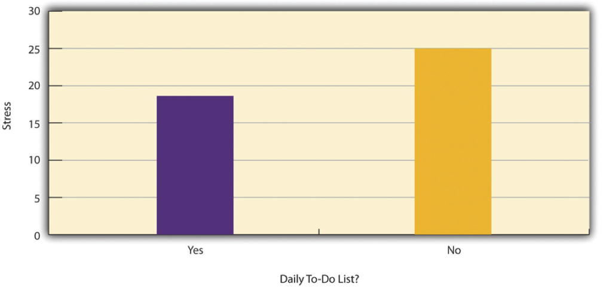
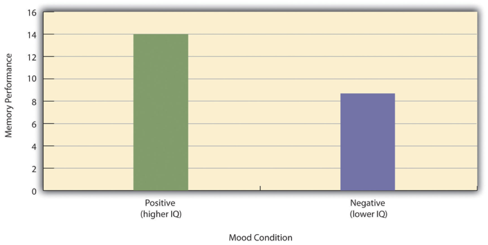

# Ch.2: Research Questions/Claims and Designs

<!--YS edit 20260721--> 
As we discussed in the previous chapter, scientific research is conducted to answer empirical questions about the world, and the results of research are often summarized in the form of claims. In this chapter, we will examine the core components of these claims and how to evaluate them.

## Basic Concepts

### Learning Objectives {.unnumbered}

1. Define a variable and a constant in a research context.
1. Distinguish between measured and manipulated variables.
1. Define conceptual and operational definitions of variables.
1. Define a population and a sample in a research context.

### Variables

A variable is a quantity or quality that varies across people or situations. Variables are the core unit of research questions and claims in psychology.

<!--YS edit 20260721--> By definition, a variable must have **at least two levels** (possible values). For example, the height of the students enrolled in a university course is a variable because it varies from student to student. The major of the Bryn Mawr students is also a variable as long as the college offers more than one major (we do!). Other examples of variables include talkativeness, depression level, number of siblings, social media engagement, nationality, occupation, psychotherapy status, and diet type (e.g., vegan vs. non-vegan). In contrast, a **constant** is a quality that does not vary within a specific study. For example, when you are interested in the relationship between class time and student performance in a course, and if only one professor teaches the course, then "professor" is a constant because it has only one level in that study. 

<!-- YS addition 20260721 -->
Variables are **measured or manipulated** in research. For example, you might measure the height of students in a course and their diet in their childhood and examine the relationship between these two variables. You did not manipulate these variables and simply measured them. In contrast, you might manipulate the kind of snacks students are given in a course and then measure their level of talkativeness. In this case, you manipulated the snack variable and measured the talkativeness variable.

#### Constructs and Operational Definitions

Many variables studied by psychologists are straightforward and simple to measure. These include sex, age, height, weight, and birth order. You can ask people how old they are and be reasonably sure that they know and will tell you. Although people might not know or want to tell you how much they weigh, you can have them step onto a bathroom scale. Other variables studied by psychologists—perhaps the majority—are not so straightforward or simple to measure. We cannot accurately assess people’s level of intelligence by looking at them, and we certainly cannot put their self-esteem on a bathroom scale. These kinds of variables are called **constructs** (pronounced CON-structs) and include personality traits (e.g., extroversion), emotional states (e.g., fear), attitudes (e.g., toward taxes), and abilities (e.g., athleticism).

Psychological constructs cannot be observed directly. One reason is that they often represent tendencies to think, feel, or act in certain ways. For example, to say that a particular university student is highly extroverted does not necessarily mean that she is behaving in an extroverted way right now. In fact, she might be sitting quietly by herself, reading a book. Instead, it means that she has a general tendency to behave in extroverted ways (talking, laughing, etc.) across a variety of situations. Another reason psychological constructs cannot be observed directly is that they often involve internal processes. Fear, for example, involves the activation of certain central and peripheral nervous system structures, along with certain kinds of thoughts, feelings, and behaviors—none of which is necessarily obvious to an outside observer. Notice also that neither extroversion nor fear “reduces to” any particular thought, feeling, act, or physiological structure or process. Instead, each is a kind of summary of a complex set of behaviors and internal processes.

The **conceptual definition** of a psychological construct describes the behaviors and internal processes that make up that construct, along with how it relates to other variables. For example, a conceptual definition of neuroticism (another one of the Big Five) would be that it is people’s tendency to experience negative emotions such as anxiety, anger, and sadness across a variety of situations. This definition might also include that it has a strong genetic component, remains fairly stable over time, and is positively correlated with the tendency to experience pain and other physical symptoms.

Students sometimes wonder why, when researchers want to understand a construct like self-esteem or neuroticism, they do not simply look it up in the dictionary. One reason is that many scientific constructs do not have counterparts in everyday language (e.g., working memory capacity). More important, researchers are in the business of developing definitions that are more detailed and precise—and that more accurately describe the way the world is—than the informal definitions in the dictionary. As we will see, they do this by proposing conceptual definitions, testing them empirically, and revising them as necessary. Sometimes they throw them out altogether. This is why the research literature often includes different conceptual definitions of the same construct. In some cases, an older conceptual definition has been replaced by a newer one that fits and works better. In others, researchers are still in the process of deciding which of various conceptual definitions is the best.

An **operational definition** is a definition of a variable in terms of precisely how it is to be measured or manipulated in a specific study. For any given variable or construct, there will be multiple operational definitions. Stress is a good example. A rough conceptual definition is that stress is an adaptive response to a perceived danger or threat that involves physiological, cognitive, affective, and behavioral components. But researchers have operationally defined it in several ways. The Social Readjustment Rating Scale is a self-report questionnaire on which people identify stressful events that they have experienced in the past year and assigns points for each one depending on its severity. For example, a man who has been divorced (73 points), changed jobs (36 points), and had a change in sleeping habits (16 points) in the past year would have a total score of 125. The Daily Hassles and Uplifts Scale is similar but focuses on everyday stressors like misplacing things and being concerned about one’s weight. The Perceived Stress Scale is another self-report measure that focuses on people’s feelings of stress (e.g., “How often have you felt nervous and stressed?”). Researchers have also operationally defined stress in terms of several physiological variables including blood pressure and levels of the stress hormone cortisol.

When psychologists use multiple operational definitions of the same construct—either within a study or across studies—they are using converging operations. The idea is that the various operational definitions are “converging” or coming together on the same construct. When scores based on several different operational definitions are closely related to each other and produce similar patterns of results, this constitutes good evidence that the construct is being measured effectively and that it is useful. The various measures of stress, for example, are all correlated with each other and have all been shown to be correlated with other variables such as immune system functioning (also measured in a variety of ways) [@segerstrom_psychological_2004]. This is what allows researchers eventually to draw useful general conclusions, such as “stress is negatively correlated with immune system functioning,” as opposed to more specific and less useful ones, such as “people’s scores on the Perceived Stress Scale are negatively correlated with their white blood counts.”

### Population and Sample

Researchers in psychology are usually interested in drawing conclusions about a large group of people. This is called the population. It could be American teenagers, children with autism, professional athletes, or even just human beings—depending on the interests and goals of the researcher. But they usually study only a small subset of the population, called **sample**. For example, a researcher might measure the talkativeness of a few hundred university students with the intention of drawing conclusions about the talkativeness of men and women in general. It is important, therefore, for researchers to use a **representative sample**—one that is similar to the population in important respects.

### Key Takeaways {.unnumbered}

- A variable must have at least two levels (values), whereas a constant remains the same across all participants in a study.
- Measured variables are observed and recorded, while manipulated variables are controlled by the researcher.
- For any conceptual definition of a construct, there will be many different operational definitions or ways of measuring it. The use of multiple operational definitions, or converging operations, is a common strategy in psychological research.
- A population is the entire group of people a researcher is interested in, while a sample is a subset of that population.

### Exercises {.unnumbered}

1. **Practice**: Identify the variables in the following research questions:
    a. "How does the amount of sleep affect college students' academic performance?"
    a. "Is there a relationship between social media usage and levels of anxiety among teenagers?"
    a. "What is the prevalence of schizophrenia among adults in the United States?"
    a. "Does the type of music listened to influence mood?"

2. **Practice**: Identify variables in the following research claims:
    a. "Students who sleep more than 8 hours a night have higher GPAs than those who sleep fewer than 8 hours."
    a. "41% of U.S. teens use social media daily."

## Types of Research Questions and Claims

<!-- YS addition 20260721 -->
In this section, we will discuss three types of claims: single-variable, association, and causal claims.

### Learning Objectives {.unnumbered}

1. Describe the three types of research questions and claims.
1. Define the directionality problem and the third-variable problem, and explain how they relate to causal claims.

### Single-Variable Questions/ Claims

Some research questions in psychology are about one variable. <!--YS edit 20260721--> How frequent or common is a particular behavior or characteristic in a population? What is the average level of a particular characteristic in a population? Answers to thse types of questions are called **single-variable claims**, and they **characterize** a **single** variable by describing its average rate or frequency.

For example, how common is it for soldiers who have served in the American Military to develop post-traumatic stress disorder (PTSD) after returning from a deployment in a war zone? How talkative are American university students on average? How much time per week do school children spend online? <!--YS edit 20260721--> Notice that there is only one variable in each of these questions: PTSD, talkativeness, and time spent online. American Militery soldiers, American university students, and school children are NOT variables, but rather the populations of interest. For example, if you measure PTSD levels in 100 soldiers who have served in the American Military, the PTSD levels will vary, but every one of the 100 respondents shares the same characteristic of being a soldier who has served in the American Military. Similarly, if you measure time spent online in 1,000 school children, the time spent online will vary, but every one of the 1,000 children studied share the same characteristic of being a school child. You are not making a claim about how militery service or being a school child causes PTSD or time spent online; you are simply describing the rate or level of PTSD/ time spent online in these populations.

### Association Questions/ Claims

However, research questions in psychology are more likely to be about relationships between variables. A relationship exists between two variables when the average score on one differs systematically across the levels of the other (e.g., if the average exam score is higher among students who read the textbook versus those who did not). Studying relationships is important because instead of telling us about behaviors and psychological characteristics in isolation, it lets us make useful predictions about one variable based on the other. 

One basic form of relationship is a difference between the average scores of two groups on some variable of interest. A wide variety of research questions in psychology take this form. Are women really more talkative than men? Do people talking on a cell phone have poorer driving abilities than people not talking on a cell phone? Do people receiving Psychotherapy A tend to have fewer depressive symptoms than people receiving Psychotherapy B? Later we will also see that such relationships can involve more than two groups and that the groups can consist of the very same individuals tested at different times or under different conditions. For now, however, it is easiest to think in terms of two distinct groups.

Notice that in these examples, we are making comparisons between groups -- one group is "more likely to" or "less likely to" have a certain characteristic than the other group. Even if the comparison group is not explicitly mentioned, it is often implied in claims about relationships. For example, if we say that people taking on a cell phone are more likely to have accidents, we are implicitly comparing them to people not talking on a cell phone. 

A second basic form of relationship is a correlation between two quantitative variables, where the average score on one variable differs systematically across the levels of the other. Again, a wide variety of research questions in psychology take this form. Is being a happier person associated with being more talkative? Do people who are narcissistic tend to take more selfies? Is the effectiveness of psychotherapy associated with how much the patient likes the therapist?

Some common phrases used for association questions/claims include: 

* is associated with
* is related to
* is correlated with
* is linked to
* is tied to
* is at risk for
* are more/less likely to
* predicts

### Causal Questions/ Claims

If you find yourself somewhat dissatisfied by the association claims above and feel tempted to say that one variable "increases" or "decreases" the other (e.g., "talking on a cell phone increases the risk of having an accident"), you are not alone. Researchers are often interested in **explaining** the state of a variable by its cause. That is, they want to know **why** a variable is the way it is, and they identify another variable as the cause. 

But not all associations reflect causal relationships. This is what psychologists mean when they say, “Correlation does not imply causation.” An amusing example of this comes from a 2012 study that showed a positive correlation between the per capita chocolate consumption of a nation and the number of Nobel prizes awarded to citizens of that nation [@messerli_chocolate_2012]. It seems clear, however, that this does not mean that eating chocolate causes people to win Nobel prizes, and it would not make sense to try to increase the number of Nobel prizes won by recommending that parents feed their children more chocolate.

There are two reasons that correlation does not imply causation. The first is called the directionality problem. Two variables, X and Y, can be correlated because X causes Y or because Y causes X. Consider, for example, a study showing that whether or not people exercise is related to how happy they are—such that people who exercise are happier on average than people who do not. This relationship is consistent with the idea that exercising causes happiness, but it is also consistent with the idea that happiness causes exercise. Perhaps being happy gives people more energy or leads them to seek opportunities to socialize with others by going to the gym. The second reason that correlation does not imply causation is called the third-variable problem. Two variables, X and Y, can be related not because X causes Y, or because Y causes X, but because some third variable, Z, causes both X and Y. For example, the fact that nations that have won more Nobel prizes tend to have higher chocolate consumption probably reflects geography in that European countries tend to have higher rates of per capita chocolate consumption and invest more in education and technology (once again, per capita) than many other countries in the world. Similarly, the relationship between exercise and happiness could mean that some third variable, such as physical health, causes both of the others. Being physically healthy could cause people to exercise and cause them to be happier.

Although researchers in psychology know that correlation does not imply causation, many journalists do not. Many of the headlines suggest that a causal relationship has been demonstrated, when a careful reading of the articles shows that it has not because of the directionality and third-variable problems. Here are common phrases used for causal claims: 

* causes
* affects
* leads to
* changes
* increases/ decreases
* enhances / diminishes
* helps/ hurts
* promotes / prevents / reduces
* alleviates / worsens

When you see these phrases in a research article, you should be careful to check whether the causal claim is justified by the research design and data. 

So when can we make causal claims? We can make causal claims when we are confident that changing one variable (called the **independent variable**) produces a change in another variable (called the **dependent variable**). For example, we may claim that a treatment reduces depressive symptoms when changing the type of treatment a patient receives produces a change in the level of depressive symptoms, and the measured change is not attributable to other factors (e.g., a new development in the patient's financial circumstances that caused changes in both the treatment plan and depressive symptoms). Note that, to make causal claims, it is important to rule out alternative explanations for the observed change in the depressive symptoms. We will get to this point in the next section on causal criteria.

### Key Takeaways {.unnumbered}

- Single-variable claims characterize the state of a single variable in a population.
- Association claims identify the relationship between two variables, which can be in the form of group differences or correlations, and allow us to make predictions about one variable based on the other variable.
- Causal claims identify the cause-and-effect relationship between two variables,where changes in one variable causes changes in the other variable, and allow us to explain a phenomenon.

### Exercises {.unnumbered}

1. **Practice**: Identify the type of research claim (single-variable, association, or causal) in the following statements:
    a. "42% of European adults never exercise."
    a. "Meditation enhances attention span."
    a. "33% of U.S. adolescents have tried smoking cigarettes."
    a. "Kids in private school smoke less than kids in public school."
    a. "Smoking is tied to depression."
    a. "Want a higher GPA? Go to a private college."
    a. "Romantic partners who express gratitude are three times more likely to stay together."
    a. "One glass of wine a day reduces the risk of heart disease."

1. **Discuss**: A study found that children who ate candy daily were more likely than other children to be arrested for violent offenses later in life. A journalist reported this with the headline "Lots of Candy Could Lead to Violence." Could candy really “lead to” violence, as the headline suggests? What alternative explanations can you think of for this association? How could the headline be rewritten so that it is not misleading?

## Causal Criteria

The 19th century philosopher John Stuart Mill proposed a set of criteria for establishing causal relationships between variables. These criteria are still widely used in psychology and other sciences today. In this section, we will discuss the three most important criteria for establishing causality: (1) the cause was associated with the effect (covariance), (2) the cause preceded the effect in time (temporal precedence), and (3) there are no plausible alternative explanations for the effect (internal validity).

### Learning Objectives {.unnumbered}
1. Explain the three causal criteria: covariance, temporal precedence, and internal validity.

### Covariance

Covariance means that there is an association between the cause and the effect. There should be a systematic relationship between variables. That is, there is a consistent pattern where the dependent variable differs across levels of the independent variable. For example, the exercise group and the non-exercise group should have different levels of happiness; or, if we are just measuring happiness and exercise, the more people exercise, the happier they should be. However, covariance alone does not establish causality. Causation implies correlation, but correlation does not imply causation. 

### Temporal Precedence

The cause must precede the effect in time. This means that the cause must occur before the effect, and not at the same time or after the effect. In psychological research, temporal precedence is often established by _manipulating_ the independent variable before measuring the dependent variable. This resolves the directionality problem. For example, if we manipulate the amount of exercise people engage in and then measure their happiness, happiness cannot be causing exercise. However, simply measuring one variable before another does not necessarily establish temporal precedence. The key issue is whether we know what the outcome variable looked like BEFORE the cause began. For example, if we measure people's exercise levels today and their happiness levels tomorrow and find a correlation, we still cannot conclude that exercise causes happiness because we don't know their baseline happiness before they exercised. Perhaps people who were already happier chose to exercise more, but we just don't know that they were happy yesterday too. 

### Internal Validity

Internal validity requires ruling out alternative explanations. To establish internal validity, the only thing that should differ between levels of the independent variable is the independent variable itself, and nothing else. In the exercise and happiness example, the exercise group and non-exercise group should be matched on physical health, diet, sleep, and social support. If they differ on any of these variables, we cannot determine whether exercise or these other factors caused the difference in happiness. In the next section, we will discuss how researchers design studies to control for these confounding variables.

### Key Takeaways {.unnumbered}
- Covariance means that there is an association between the two variables.
- Temporal Precedence means that the cause must come before the effect in time, and it resolves the directionality problem.
- Internal Validity means that you have ruled out alternative explanations for the observed effect, and it addresses the third-variable problem.
- Correlation does not imply causation.

### Exercises {.unnumbered}
1. **Practice**: Evaluate this study for the three causal criteria.
    A researcher wants to know if playing wind instruments improves respiratory function. They compare lung capacity of musicians who play wind instruments (like flute or trumpet) and non-musicians, and find that the musicians have greater lung capacity.

## Research Designs

### Learning Objectives {.unnumbered}
1. Explain the types of research designs: single-variable, correlational, experimental, and quasi-experimental.
2. Evaluate the strengths and weaknesses of each research design in terms of the three causal criteria.

### Single-Variable Studies
Research can focus on characterizing the state of a single variable. Although there is no widely shared term for this kind of research, we will call it single-variable research. For example, Stanley Milgram found that about two thirds of his research participants were willing to administer dangerous shocks to another person just because they were told to by an authority figure [@milgram_behavioral_1963]. He was primarily interested in one variable—the extent to which participants obeyed the researcher when he told them to shock the confederate—and he observed all participants performing the same task under the same conditions. 

In another example of single-variable research, Elizabeth Loftus and Jacqueline Pickrell showed that it is relatively easy to “implant” false memories in people by repeatedly asking them about childhood events that did not actually happen to them [@loftus_formation_1995]. The variable was whether participants “remembered” having experienced mildly traumatic childhood events (e.g., getting lost in a shopping mall) that they had not actually experienced but that the research asked them about repeatedly. In this particular study, nearly a third of the participants “remembered” at least one event. (As with Milgram’s original study, this study inspired several later experiments on the factors that affect false memories.)

As these examples make clear, single-variable research can answer interesting and important questions. What it cannot do, however, is answer questions about statistical relationships between variables. This detail is a point that beginning researchers sometimes miss. Imagine, for example, a group of research methods students interested in the relationship between children’s being the victim of bullying and the children’s self-esteem. The first thing that is likely to occur to these researchers is to obtain a sample of middle-school students who have been bullied and then to measure their self-esteem. But this design would be a single-variable study with self-esteem as the only variable. Although it would tell the researchers something about the self-esteem of children who have been bullied, it would not tell them what they really want to know, which is how the self-esteem of children who have been bullied compares with the self-esteem of children who have not. Is it lower? Is it the same? Could it even be higher? To answer this question, their sample would also have to include middle-school students who have not been bullied thereby introducing another variable.


### Correlational Studies
Research can also focus on a statistical relationship between two variables and answer associative questions, without making causal inferences. In correlational research, the researcher measures the two variables of interest with little or no attempt to control extraneous variables and then assesses the relationship between them. A research methods student who finds out whether each of several middle-school students has been bullied and then measures each student’s self-esteem is conducting correlational research. 

There are essentially two reasons that researchers interested in statistical relationships between variables would choose to conduct a correlational study. The first is that they do not believe that the statistical relationship is a causal one. For example, a researcher might evaluate the validity of a brief extraversion test by administering it to a large group of participants along with a longer extraversion test that has already been shown to be valid. This researcher might then check to see whether participants’ scores on the brief test are strongly correlated with their scores on the longer one. Neither test score is thought to cause the other

The other reason that researchers would choose to use a correlational study is that the statistical relationship of interest is thought to be causal, but the researcher cannot manipulate the independent variable because it is impossible, impractical, or unethical. For example, Allen Kanner and his colleagues thought that the number of “daily hassles” (e.g., rude salespeople, heavy traffic) that people experience affects the number of physical and psychological symptoms they have [@kanner_comparison_1981]. But because they could not manipulate the number of daily hassles their participants experienced, they had to settle for measuring the number of daily hassles—along with the number of symptoms—using self-report questionnaires. Although the strong positive relationship they found between these two variables is consistent with their idea that hassles cause symptoms, it is also consistent with the idea that symptoms cause hassles or that some third variable (e.g., neuroticism) causes both.

A common misconception among beginning researchers is that correlational research must involve two quantitative variables, such as scores on two extraversion tests or the number of hassles and number of symptoms people have experienced. However, the defining feature of correlational research is that the two variables are measured—neither one is manipulated—and this is true regardless of whether the variables are quantitative or categorical. Imagine, for example, that a researcher administers the Rosenberg Self-Esteem Scale to 50 American university students and 50 Japanese university students. Although this “feels” like a between-subjects experiment, it is a correlational study because the researcher did not manipulate the students’ nationalities. The same is true of the study by Cacioppo and Petty comparing professors and factory workers in terms of their need for cognition. It is a correlational study because the researchers did not manipulate the participants’ occupations.


```{r echo=FALSE}
#| label: fig-c9daily
#| fig-cap: "Results of a Hypothetical Study on Whether People Who Make Daily To-Do Lists Experience Less Stress Than People Who Do Not Make Such Lists."
#| fig-alt: "A bar graph with x-axis labeled 'Daily To-Do List?' and two bars, one for 'Yes' and one for 'No'. The y-axis is labeled 'Stress' and the bar for 'Yes' is lower than the bar for 'No'."

```

@fig-c9daily shows data from a hypothetical study on the relationship between whether people make a daily list of things to do (a “to-do list”) and stress. Notice that it is unclear whether this design is a correlational study or an experiment because it is unclear whether the independent variable was manipulated. If the researcher randomly assigned some participants to make daily to-do lists and others not to, then it is an experiment. If the researcher simply asked participants whether they made daily to-do lists, then it is a correlational study. The distinction is important because if the study was an experiment, then it could be concluded that making the daily to-do lists reduced participants’ stress. But if it was a correlational study, it could only be concluded that these variables are related. Perhaps being stressed has a negative effect on people’s ability to plan ahead (the directionality problem). Or perhaps people who are more conscientious are more likely to make to-do lists and less likely to be stressed (the third-variable problem). The crucial point is that what defines a study as experimental or correlational is not the variables being studied, nor whether the variables are quantitative or categorical, nor the type of graph or statistics used to analyze the data. It is how the study is conducted.

### Experimental Studies

The primary goal of experiments is to identify causal relationships between things in the world. Experiments do this by a systematic process of measuring how things behave under different conditions.

People conduct informal experiments all of the time. For example, when you walk into an unfamiliar room and want to turn on a light, what do you do? You find the light switch panel, and then you flip the switches until you find the one that turns a particular light on or off. This process is called trial and error, and involves trying things out until they work. The process of figuring out which switch causes a particular light to turn on or off is very similar to the process of conducting experiments. Let’s use the light-switch example to define some important terms, and then discuss the logic of running an experiment and making inferences about the data that is collected in an experiment.

Experiments begin with a question about a potential causal relationship between two variables. For example, which switch on the panel caused light 1 to turn on? When you flick the switches and look at the lights, you are actually accomplishing three important parts of an experiment: manipulating the independent variables, measuring the dependent variable, and controlling extraneous variables.

The independent variable is the manipulation of different conditions that a researcher controls. The light switches are independent variables that can be manipulated. For example, the first light switch can be up or down, the second light switch can be up or down, and so on.

The dependent variable is the measurement of interest. Each light bulb is a dependent variable that we can measure. For example, we observe whether a light is on off, or perhaps use a special photometer to measure the brightness of the light.

Let’s look at an experiment asking if light switch 1 causes the first light to turn on or off. The experiment involves manipulating switch 1 by turning it up or down, and then observing whether the light turns on or off. There are two simple outcomes. Possible outcome 1 is that the light stays off in both conditions. What inference can we make based off of this pattern of data? In most situations, people would be comfortable with inferring that switch 1 does not cause Light 1 to turn on and off. Possible outcome 2 is that the light turns on when the switch is up, and turns off when the switch is down. What inference can we make based off of this pattern of data? In most situations, people would be comfortable with inferring that switch 1 does cause Light 1 to turn on and off.

It would be nice if the process of figuring out what causes what is as simple as the light-switch example, but even this example is not as simple as it seems. The biggest complication is the inference part. We discussed two plausible inferences for outcomes 1 and 2. However, these inferences might not be true.

For outcome 1 when the light doesn’t turn on, what could be wrong about our inference that switch 1 does not control light 1? Perhaps that switch is wired up to control light 1, but the light is broken; perhaps the wire got disconnected; or, perhaps the light did turn on, but you couldn’t see it because the brightness was very low.

For outcome 2 when the light does turn on, what could be wrong about our inference that switch 1 does control light 1? Here, we at least know that the light works, so we can be confident in our measure of the dependent variable? But, how confident our we that our manipulation of the light switch was the only variable changing in our experiment? This depends on how well the experiment controls extraneous or confounding variables, that might be responsible for the light turning on or off. If you can guarantee that the the only change was switch 1 going up and down, then you can be confident of the inference that switch 1 caused light 1 to turn on and off.

Let’s consider a problematic version of the experiment where you are not controlling other possible confounding variables. For example, pretend that every time you test switch 1, a friend is also testing a different switch. You turn switch 1 up, your friend turns switch 2 up. You turn switch 1 down, your friend turns switch 2 down. If the light turns on and off when the switches go up and down, then what can you infer about light switch 1? Well, switch 1 might control light 1, but so could switch 2. The only way to infer that switch 1 was controlling the light is to eliminate the influence of other possible variables. So, you need to ask your friend to stop testing other switches while you focus on testing switch 1.

To summarize, experiments attempt to discover the causal forces between things in the world. Researchers manipulate the independent variable by systematically changing it across different conditions. And, they measure the dependent variable to see if it changes in any of the conditions. The goal is to make inferences about whether the independent variable causes change in the dependent variable. Generally, when no change in the dependent variable is observed, we infer that the independent variable does not causally influence the dependent variable. But, this strong inference is only valid when the experiment is designed properly so that the researcher can guarantee that they (1) actually varied the independent variable, and (2) they could actually measure possible changes in the dependent variable without error. When the dependent variable does show change across the conditions of the independent variable, then we infer that the independent variable causes change in the dependent variable. But, this strong inference is only valid when the experiment can guarantee that all extraneous or confounding variables were held constant across the conditions of the independent variable.

In psychological experiments, the goal of figuring out what causes what is rarely accomplished by a single experiment. Instead, our inferences about causal relationships are strengthened over many experiments that improve our ability to measure variables of interest, and to create well-controlled conditions where the independent variables are not confounded by extraneous influences.

#### An example Psychology Experiment

In the late 1960s social psychologists John Darley and Bibb Latané proposed a counter-intuitive hypothesis. The more witnesses there are to an accident or a crime, the less likely any of them is to help the victim [@darley_bystander_1968].

They also suggested the theory that this phenomenon occurs because each witness feels less responsible for helping—a process referred to as the “diffusion of responsibility.” Darley and Latané noted that their ideas were consistent with many real-world cases. For example, a New York woman named Catherine “Kitty” Genovese was assaulted and murdered while several witnesses evidently failed to help. But Darley and Latané also understood that such isolated cases did not provide convincing evidence for their hypothesized “bystander effect.” There was no way to know, for example, whether any of the witnesses to Kitty Genovese’s murder would have helped had there been fewer of them.

So to test their hypothesis, Darley and Latané created a simulated emergency situation in a laboratory. Each of their university student participants was isolated in a small room and told that he or she would be having a discussion about university life with other students via an intercom system. Early in the discussion, however, one of the students began having what seemed to be an epileptic seizure. Over the intercom came the following: “I could really-er-use some help so if somebody would-er-give me a little h-help-uh-er-er-er-er-er c-could somebody-er- er-help-er-uh-uh-uh (choking sounds)...I’m gonna die-er-er-I’m...gonna die-er-help-er-er-seizure-er- [chokes, then quiet]” [@darley_bystander_1968].

In actuality, there were no other students. These comments had been prerecorded and were played back to create the appearance of a real emergency. The key to the study was that some participants were told that the discussion involved only one other student (the victim), others were told that it involved two other students, and still others were told that it included five other students. Because this was the only difference between these three groups of participants, any difference in their tendency to help the victim would have to have been caused by it. And sure enough, the likelihood that the participant left the room to seek help for the “victim” decreased from 85% to 62% to 31% as the number of “witnesses” increased.

The story of Kitty Genovese has been told and retold in numerous psychology textbooks. The standard version is that there were 38 witnesses to the crime, that all of them watched (or listened) for an extended period of time, and that none of them did anything to help. However, recent scholarship suggests that the standard story is inaccurate in many ways [@manning_kitty_2007]. For example, only six eyewitnesses testified at the trial, none of them was aware that he or she was witnessing a lethal assault, and there have been several reports of witnesses calling the police or even coming to the aid of Kitty Genovese. Although the standard story inspired a long line of research on the bystander effect and the diffusion of responsibility, it may also have directed researchers’ and students’ attention away from other equally interesting and important issues in the psychology of helping—including the conditions in which people do in fact respond collectively to emergency situations.

The research that Darley and Latané conducted was a particular kind of study called an experiment. Experiments are used to determine not only whether there is a meaningful relationship between two variables but also whether the relationship is a causal one that is supported by statistical analysis. For this reason, experiments are one of the most common and useful tools in the psychological researcher’s toolbox. 


#### Manipulation of the Independent Variable

To manipulate an independent variable means to change its level systematically so that different groups of participants are exposed to different levels of that variable, or the same group of participants is exposed to different levels at different times. For example, to see whether expressive writing affects people’s health, a researcher might instruct some participants to write about traumatic experiences and others to write about neutral experiences. As discussed earlier in this chapter, the different levels of the independent variable are referred to as conditions, and researchers often give the conditions short descriptive names to make it easy to talk and write about them. In this case, the conditions might be called the “traumatic condition” and the “neutral condition.”

Notice that the manipulation of an independent variable must involve the active intervention of the researcher. Comparing groups of people who differ on the independent variable before the study begins is not the same as manipulating that variable. For example, a researcher who compares the health of people who already keep a journal with the health of people who do not keep a journal has not manipulated this variable and therefore not conducted an experiment. This distinction is important because groups that already differ in one way at the beginning of a study are likely to differ in other ways too. For example, people who choose to keep journals might also be more conscientious, more introverted, or less stressed than people who do not. Therefore, any observed difference between the two groups in terms of their health might have been caused by whether or not they keep a journal, or it might have been caused by any of the other differences between people who do and do not keep journals. Thus the active manipulation of the independent variable is crucial for eliminating the third-variable problem.

Of course, there are many situations in which the independent variable cannot be manipulated for practical or ethical reasons and therefore an experiment is not possible. For example, whether or not people have a significant early illness experience cannot be manipulated, making it impossible to conduct an experiment on the effect of early illness experiences on the development of hypochondriasis. This caveat does not mean it is impossible to study the relationship between early illness experiences and hypochondriasis—only that it must be done using nonexperimental approaches such as correlational studies. 

In many experiments, the independent variable is a construct that can only be manipulated indirectly. For example, a researcher might try to manipulate participants’ stress levels indirectly by telling some of them that they have five minutes to prepare a short speech that they will then have to give to an audience of other participants. In such situations, researchers often include a **manipulation check** in their procedure. A manipulation check is a separate measure of the construct the researcher is trying to manipulate. For example, researchers trying to manipulate participants’ stress levels might give them a paper-and-pencil stress questionnaire or take their blood pressure—perhaps right after the manipulation or at the end of the procedure—to verify that they successfully manipulated this variable.

#### Control of Extraneous Variables

An extraneous variable is anything that varies in the context of a study other than the independent and dependent variables. In an experiment on the effect of expressive writing on health, for example, extraneous variables would include participant variables (individual differences) such as their writing ability, their diet, and their shoe size. They would also include situational or task variables such as the time of day when participants write, whether they write by hand or on a computer, and the weather. Extraneous variables pose a problem because many of them are likely to have some effect on the dependent variable. For example, participants’ health will be affected by many things other than whether or not they engage in expressive writing. This influencing factor can make it difficult to separate the effect of the independent variable from the effects of the extraneous variables, which is why it is important to control extraneous variables by holding them constant.

Extraneous variables make it difficult to detect the effect of the independent variable in two ways. One is by adding variability or **noise** to the data. This type of extraneous variables is also called "nuisance" variables. Imagine a simple experiment on the effect of mood (happy vs. sad) on the number of happy childhood events people are able to recall. Participants are put into a negative or positive mood (by showing them a happy or sad video clip) and then asked to recall as many happy childhood events as they can. If there are no extraneous variables and the number of happy childhood events participants recalled was affected only by their moods, every participant in the happy mood condition would recall exactly four happy childhood events, and every participant in the sad mood condition would recall exactly three. The effect of mood here is quite obvious. In reality, however, the data would probably look more noisy. Even in the happy mood condition, some participants would recall fewer happy memories because they have fewer to draw on, use less effective recall strategies, or are less motivated. And even in the sad mood condition, some participants would recall more happy childhood memories because they have more happy memories to draw on, they use more effective recall strategies, or they are more motivated. Although the mean difference between the two groups is the same as in the idealized data, this difference is much less obvious in the context of the greater variability in the data. Thus one reason researchers try to control extraneous variables is so their data look more like the idealized data, which makes the effect of the independent variable easier to detect (although real data never look quite that good).

One way to control extraneous variables is to hold them constant. This technique can mean holding situation or task variables constant by testing all participants in the same location, giving them identical instructions, treating them in the same way, and so on. It can also mean holding participant variables constant. For example, many studies of language limit participants to right-handed people, who generally have their language areas isolated in their left cerebral hemispheres. Left-handed people are more likely to have their language areas isolated in their right cerebral hemispheres or distributed across both hemispheres, which can change the way they process language and thereby add noise to the data.

In principle, researchers can control extraneous variables by limiting participants to one very specific category of person, such as 20-year-old, heterosexual, female, right-handed psychology majors. The obvious downside to this approach is that it would lower the external validity of the study—in particular, the extent to which the results can be generalized beyond the people actually studied. For example, it might be unclear whether results obtained with a sample of younger heterosexual women would apply to older homosexual men. In many situations, the advantages of a diverse sample outweigh the reduction in noise achieved by a homogeneous one.

The second way that extraneous variables can make it difficult to detect the effect of the independent variable is by becoming **confounding variables**. A confounding variable is an extraneous variable that systematically differs on average across levels of the independent variable. For example, in almost all experiments, participants’ intelligence quotients (IQs) will be an extraneous variable. But as long as there are participants with lower and higher IQs at each level of the independent variable so that the average IQ is roughly equal, then this variation is probably acceptable (and may even be desirable). What would be bad, however, would be for participants at one level of the independent variable to have substantially lower IQs on average and participants at another level to have substantially higher IQs on average. In this case, IQ would be a confounding variable.


```{r echo=FALSE}
#| label: fig-c4confound
#| fig-cap: "Hypothetical Results From a Study on the Effect of Mood on Memory. Because IQ also differs across conditions, it is a confounding variable"
#| fig-alt: "A bar graph with x-axis labeled 'Mood Condition' and two bars, one for 'Positive (higher IQ)' and one for 'Negative (lower IQ)'. The y-axis is labeled 'Memory Performance' and the bar for 'Positive' is higher than the bar for 'Negative'."


```

To confound means to confuse, and this effect is exactly why confounding variables are undesirable. Because they differ across conditions—just like the independent variable—they provide an alternative explanation for any observed difference in the dependent variable. @fig-c4confound shows the results of a hypothetical study, in which participants in a positive mood condition scored higher on a memory task than participants in a negative mood condition. But if IQ is a confounding variable—with participants in the positive mood condition having higher IQs on average than participants in the negative mood condition—then it is unclear whether it was the positive moods or the higher IQs that caused participants in the first condition to score higher. One way to avoid confounding variables is by holding extraneous variables constant. For example, one could prevent IQ from becoming a confounding variable by limiting participants only to those with IQs of exactly 100. But this approach is not always desirable for reasons we have already discussed. A second and much more general approach—random assignment to conditions—will be discussed in detail shortly.

#### Between-Subjects Experiments and Random Assignment

In a between-subjects experiment, each participant is tested in only one condition. For example, a researcher with a sample of 100 university students might assign half of them to write about a traumatic event and the other half write about a neutral event. Or a researcher with a sample of 60 people with severe agoraphobia (fear of open spaces) might assign 20 of them to receive each of three different treatments for that disorder. It is essential in a between- subjects experiment that the researcher assign participants to conditions so that the different groups are, on average, highly similar to each other. Those in a trauma condition and a neutral condition, for example, should include a similar proportion of men and women, and they should have similar average intelligence quotients (IQs), similar average levels of motivation, similar average numbers of health problems, and so on. This matching is a matter of controlling these extraneous participant variables across conditions so that they do not become confounding variables.

The primary way that researchers accomplish this kind of control of extraneous variables across conditions is called **random assignment**, which means using a random process to decide which participants are tested in which conditions. Do not confuse random assignment with random sampling. Random sampling is a method for selecting a sample from a population, and it is rarely used in psychological research. Random assignment is a method for assigning participants in a sample to the different conditions, and it is an important element of all experimental research in psychology and other fields too.

Random assignment is not guaranteed to control all extraneous variables across conditions. It is always possible that just by chance, the participants in one condition might turn out to be substantially older, less tired, more motivated, or less depressed on average than the participants in another condition. However, random assignment works better than one might expect, especially for large samples. Random assignment to conditions—although not infallible in terms of controlling extraneous variables—is always considered a strength of a research design.

#### Within-Subjects Experiments and Counterbalancing

In a within-subjects experiment, each participant is tested under all conditions. Consider an experiment on the effect of a defendant’s physical attractiveness on judgments of his guilt. Again, in a between-subjects experiment, one group of participants would be shown an attractive defendant and asked to judge his guilt, and another group of participants would be shown an unattractive defendant and asked to judge his guilt. In a within-subjects experiment, however, the same group of participants would judge the guilt of both an attractive and an unattractive defendant.

The primary advantage of this approach is that it provides maximum control of extraneous participant variables. Participants in all conditions have the same mean IQ, same socioeconomic status, same number of siblings, and so on—because they are the very same people. Within-subjects experiments also make it possible to use statistical procedures that remove the effect of these extraneous participant variables on the dependent variable and therefore make the data less “noisy” and the effect of the independent variable easier to detect. We will look more closely at this idea later in the book. However, not all experiments can use a within-subjects design nor would it be desirable to.

The primary disadvantage of within-subjects designs is that they can result in carryover effects. A carryover effect is an effect of being tested in one condition on participants’ behavior in later conditions. One type of carryover effect is a practice effect, where participants perform a task better in later conditions because they have had a chance to practice it. Another type is a fatigue effect, where participants perform a task worse in later conditions because they become tired or bored. Being tested in one condition can also change how participants perceive stimuli or interpret their task in later conditions. This type of effect is called a context effect. For example, an average-looking defendant might be judged more harshly when participants have just judged an attractive defendant than when they have just judged an unattractive defendant. Within-subjects experiments also make it easier for participants to guess the hypothesis. For example, a participant who is asked to judge the guilt of an attractive defendant and then is asked to judge the guilt of an unattractive defendant is likely to guess that the hypothesis is that defendant attractiveness affects judgments of guilt. This knowledge could lead the participant to judge the unattractive defendant more harshly because he thinks this is what he is expected to do. Or it could make participants judge the two defendants similarly in an effort to be “fair.”

Carryover effects can be interesting in their own right. (Does the attractiveness of one person depend on the attractiveness of other people that we have seen recently?) But when they are not the focus of the research, carryover effects can be problematic. Imagine, for example, that participants judge the guilt of an attractive defendant and then judge the guilt of an unattractive defendant. If they judge the unattractive defendant more harshly, this might be because of his unattractiveness. But it could be instead that they judge him more harshly because they are becoming bored or tired. In other words, the order of the conditions is a confounding variable. The attractive condition is always the first condition and the unattractive condition the second. Thus any difference between the conditions in terms of the dependent variable could be caused by the order of the conditions and not the independent variable itself.

There is a solution to the problem of order effects, however, that can be used in many situations. It is counterbalancing, which means testing different participants in different orders. For example, some participants would be tested in the attractive defendant condition followed by the unattractive defendant condition, and others would be tested in the unattractive condition followed by the attractive condition. With three conditions, there would be six different orders (ABC, ACB, BAC, BCA, CAB, and CBA), so some participants would be tested in each of the six orders. With counterbalancing, participants are assigned to orders randomly, using the techniques we have already discussed. Thus random assignment plays an important role in within-subjects designs just as in between- subjects designs. Here, instead of randomly assigning to conditions, they are _randomly assigned to different orders of conditions_. In fact, it can safely be said that if a study does not involve random assignment in one form or another, it is not an experiment.

### Quasi-Experimental Studies

The prefix quasi means “resembling.” Thus quasi-experimental research is research that resembles experimental research but is not true experimental research. Although the independent variable is manipulated, participants are not randomly assigned to conditions or orders of conditions [@cook_quasi-experimentation:_1979]. Because the independent variable is manipulated before the dependent variable is measured, quasi-experimental research eliminates the directionality problem. But because participants are not randomly assigned—making it likely that there are other differences between conditions—quasi-experimental research does not eliminate the problem of confounding variables. In terms of internal validity, therefore, quasi-experiments are generally somewhere between correlational studies and true experiments.

Quasi-experiments are most likely to be conducted in field settings in which random assignment is difficult or impossible. They are often conducted to evaluate the effectiveness of a treatment—perhaps a type of psychotherapy or an educational intervention. There are many different kinds of quasi-experiments, but we will discuss just a few of the most common ones here.

#### Pretest-Posttest Design

In a pretest-posttest design, the dependent variable is measured once before the treatment is implemented and once after it is implemented. Imagine, for example, a researcher who is interested in the effectiveness of an antidrug education program on elementary school students’ attitudes toward illegal drugs. The researcher could measure the attitudes of students at a particular elementary school during one week, implement the antidrug program during the next week, and finally, measure their attitudes again the following week. The pretest-posttest design is much like a within-subjects experiment in which each participant is tested first under the control condition and then under the treatment condition. It is unlike a within-subjects experiment, however, in that the order of conditions is not counterbalanced because it typically is not possible for a participant to be tested in the treatment condition first and then in an “untreated” control condition.

If the average posttest score is better than the average pretest score, then it makes sense to conclude that the treatment might be responsible for the improvement. Unfortunately, one often cannot conclude this with a high degree of certainty because there may be other explanations for why the posttest scores are better. One category of alternative explanations goes under the name of history. Other things might have happened between the pretest and the posttest. Perhaps an antidrug program aired on television and many of the students watched it, or perhaps a celebrity died of a drug overdose and many of the students heard about it.

Another category of alternative explanations goes under the name of maturation. Participants might have changed between the pretest and the posttest in ways that they were going to anyway because they are growing and learning. If it were a yearlong program, participants might become less impulsive or better reasoners and this might be responsible for the change.

Another alternative explanation for a change in the dependent variable in a pretest-posttest design is regression to the mean. This refers to the statistical fact that an individual who scores extremely on a variable on one occasion will tend to score less extremely on the next occasion. For example, a bowler with a long-term average of 150 who suddenly bowls a 220 will almost certainly score lower in the next game. Her score will “regress” toward her mean score of 150. Regression to the mean can be a problem when participants are selected for further study because of their extreme scores. Imagine, for example, that only students who scored especially low on a test of fractions are given a special training program and then retested. Regression to the mean all but guarantees that their scores will be higher even if the training program has no effect. A closely related concept—and an extremely important one in psychological research—is spontaneous remission. This is the tendency for many medical and psychological problems to improve over time without any form of treatment. The common cold is a good example. If one were to measure symptom severity in 100 common cold sufferers today, give them a bowl of chicken soup every day, and then measure their symptom severity again in a week, they would probably be much improved. This does not mean that the chicken soup was responsible for the improvement, however, because they would have been much improved without any treatment at all. The same is true of many psychological problems. A group of severely depressed people today is likely to be less depressed on average in 6 months. In reviewing the results of several studies of treatments for depression, researchers Michael Posternak and Ivan Miller found that participants in waitlist control conditions improved an average of 10 to 15% before they received any treatment at all [@posternak_untreated_2001]. Thus one must generally be very cautious about inferring causality from pretest-posttest designs.

Early studies on the effectiveness of psychotherapy tended to use pretest-posttest designs. In a classic 1952 article, researcher Hans Eysenck summarized the results of 24 such studies showing that about two thirds of patients improved between the pretest and the posttest [@eysenck_effects_1952]. But Eysenck also compared these results with archival data from state hospital and insurance company records showing that similar patients recovered at about the same rate without receiving psychotherapy. This parallel suggested to Eysenck that the improvement that patients showed in the pretest-posttest studies might be no more than spontaneous remission. Note that Eysenck did not conclude that psychotherapy was ineffective. He merely concluded that there was no evidence that it was, and he wrote of “the necessity of properly planned and executed experimental studies into this important field” (p. 323).

Fortunately, many other researchers took up Eysenck’s challenge, and by 1980 hundreds of experiments had been conducted in which participants were randomly assigned to treatment and control conditions, and the results were summarized in a classic book by Mary Lee Smith, Gene Glass, and Thomas Miller [@smith_benefits_1980]. They found that overall psychotherapy was quite effective, with about 80% of treatment participants improving more than the average control participant. Subsequent research has focused more on the conditions under which different types of psychotherapy are more or less effective.

#### Nonequivalent Groups Design

Recall that when participants in a between-subjects experiment are randomly assigned to conditions, the resulting groups are likely to be quite similar. In fact, researchers consider them to be equivalent. When participants are not randomly assigned to conditions, however, the resulting groups are likely to be dissimilar in some ways. For this reason, researchers consider them to be nonequivalent. A nonequivalent groups design, then, is a between-subjects design in which participants have not been randomly assigned to conditions.

Imagine, for example, a researcher who wants to evaluate a new method of teaching fractions to third graders. One way would be to conduct a study with a treatment group consisting of one class of third-grade students and a control group consisting of another class of third-grade students. This design would be a nonequivalent groups design because the students are not randomly assigned to classes by the researcher, which means there could be important differences between them. For example, the parents of higher achieving or more motivated students might have been more likely to request that their children be assigned to Ms. Williams’s class. Or the principal might have assigned the “troublemakers” to Mr. Jones’s class because he is a stronger disciplinarian. Of course, the teachers’ styles, and even the classroom environments, might be very different and might cause different levels of achievement or motivation among the students. If at the end of the study there was a difference in the two classes’ knowledge of fractions, it might have been caused by the difference between the teaching methods—but it might have been caused by any of these confounding variables.

Of course, researchers using a nonequivalent groups design can take steps to ensure that their groups are as similar as possible. In the present example, the researcher could try to select two classes at the same school, where the students in the two classes have similar scores on a standardized math test and the teachers are the same sex, are close in age, and have similar teaching styles. Taking such steps would increase the internal validity of the study because it would eliminate some of the most important confounding variables. But without true random assignment of the students to conditions, there remains the possibility of other important confounding variables that the researcher was not able to control.


### Key Takeaways {.unnumbered}
- Single-variable studies are used to answer questions about a single variable. 
- Correlational studies are used to answer association questions about the relationship between two variables.
- Experimental studies are used to answer causal questions about the effect of one variable on another by manipulating the independent variable and controlling extraneous variables so that they do not become confounding variables.
- Random assignment to conditions in between-subjects experiments or to orders of conditions in within-subjects experiments is a fundamental element of experimental research. 
- Quasi-experimental research involves the manipulation of an independent variable without the random assignment of participants to conditions or orders of conditions. It eliminates the directionality problem because it involves the manipulation of the independent variable. It does not eliminate the problem of confounding variables, however, because it does not involve random assignment to conditions. For these reasons, quasi-experimental research is generally higher in internal validity than correlational studies but lower than true experiments.

### Exercises {.unnumbered}
1. *Practice*: Imagine that two professors decide to test the effect of giving daily quizzes on student performance in a statistics course. They decide that Professor A will give quizzes in class but Professor B will not. They will then compare the performance of students in their two sections on a common final exam. 
    a. Which type of study is this?
    a. List three variables that might differ between the two sections that could affect the results.