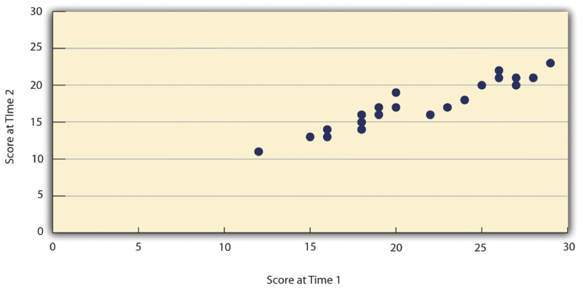
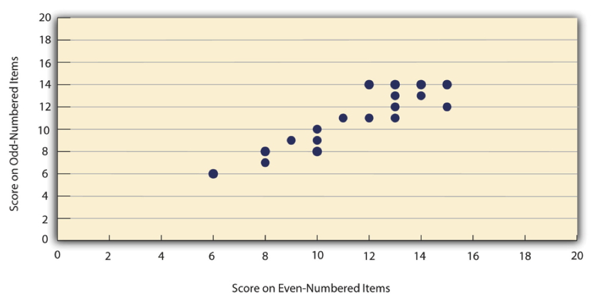

# Measurement

Researchers Tara MacDonald and Alanna Martineau were interested in the effect of female university students’ moods on their intentions to have unprotected sexual intercourse [@macdonald_self-esteem_2002]. In a carefully designed empirical study, they found that being in a negative mood increased intentions to have unprotected sex—but only for students who were low in self-esteem. Although there are many challenges involved in conducting a study like this, one of the primary ones is the measurement of the relevant variables. In this study, the researchers needed to know whether each of their participants had high or low self-esteem, which of course required measuring their self-esteem. They also needed to be sure that their attempt to put people into a negative mood (by having them think negative thoughts) was successful, which required measuring their moods. Finally, they needed to see whether self-esteem and mood were related to participants’ intentions to have unprotected sexual intercourse, which required measuring these intentions.

To students who are just getting started in psychological research, the challenge of measuring such variables might seem insurmountable. Is it really possible to measure things as intangible as self-esteem, mood, or an intention to do something? The answer is a resounding yes, and in this chapter we look closely at the nature of the variables that psychologists study and how they can be measured. We also look at some practical issues in psychological measurement.

The Rosenberg Self-Esteem Scale [@rosenberg_society_1965] is one of the most common measures of self-esteem and the one that MacDonald and Martineau used in their study. Participants respond to each of the 10 items that follow with a rating on a 4-point scale: Strongly Agree, Agree, Disagree, Strongly Disagree. Score Items 1, 2, 4, 6, and 7 by assigning 3 points for each Strongly Agree response, 2 for each Agree, 1 for each Disagree, and 0 for each Strongly Disagree. Reverse the scoring for Items 3, 5, 8, 9, and 10 by assigning 0 points for each Strongly Agree, 1 point for each Agree, and so on. The overall score is the total number of points.

1.  I feel that I’m a person of worth, at least on an equal plane with others.
2.  I feel that I have a number of good qualities.
3.  All in all, I am inclined to feel that I am a failure.
4.  I am able to do things as well as most other people.
5.  I feel I do not have much to be proud of.
6.  I take a positive attitude toward myself.
7.  On the whole, I am satisfied with myself.
8.  I wish I could have more respect for myself.
9.  I certainly feel useless at times.
10. At times I think I am no good at all.

## Understanding Psychological Measurement

### Learning Objectives {.unnumbered}
1. Explain different types of measurement in psychology.
1. Distinguish the four levels of measurement, give examples of each, and explain why this distinction is important.

### What Is Measurement?

Measurement is the assignment of scores to individuals so that the scores represent some characteristic of the individuals. This very general definition is consistent with the kinds of measurement that everyone is familiar with—for example, weighing oneself by stepping onto a bathroom scale, or checking the internal temperature of a roasting turkey by inserting a meat thermometer. It is also consistent with measurement in the other sciences. In physics, for example, one might measure the potential energy of an object in Earth’s gravitational field by finding its mass and height (which of course requires measuring those variables) and then multiplying them together along with the gravitational acceleration of Earth (9.8 m/s2). The result of this procedure is a score that represents the object’s potential energy.

This general definition of measurement is consistent with measurement in psychology too. (Psychological measurement is often referred to as psychometrics.) Imagine, for example, that a cognitive psychologist wants to measure a person’s working memory capacity—his or her ability to hold in mind and think about several pieces of information all at the same time. To do this, she might use a backward digit span task, in which she reads a list of two digits to the person and asks him or her to repeat them in reverse order. She then repeats this several times, increasing the length of the list by one digit each time, until the person makes an error. The length of the longest list for which the person responds correctly is the score and represents his or her working memory capacity. Or imagine a clinical psychologist who is interested in how depressed a person is. He administers the Beck Depression Inventory, which is a 21-item self-report questionnaire in which the person rates the extent to which he or she has felt sad, lost energy, and experienced other symptoms of depression over the past 2 weeks. The sum of these 21 ratings is the score and represents his or her current level of depression.

The important point here is that measurement does not require any particular instruments or procedures. It does not require placing individuals or objects on bathroom scales, holding rulers up to them, or inserting thermometers into them. What it does require is some systematic procedure for assigning scores to individuals or objects so that those scores represent the characteristic of interest.

### Types of Measurement

Psychological measures generally fall into one of three broad categories. Self-report measures are those in which participants report on their own thoughts, feelings, and actions, as with the Rosenberg Self-Esteem Scale. Behavioral measures are those in which some other aspect of participants’ behavior is observed and recorded. This is an extremely broad category that includes the observation of people’s behavior both in highly structured laboratory tasks and in more natural settings. A good example of the former would be measuring working memory capacity using the backward digit span task. A good example of the latter is a famous operational definition of physical aggression from researcher Albert Bandura and his colleagues [@bandura_transmission_2006]. They let each of several children play for 20 minutes in a room that contained a clown-shaped punching bag called a Bobo doll. They filmed each child and counted the number of acts of physical aggression he or she committed. These included hitting the doll with a mallet, punching it, and kicking it. Their operational definition, then, was the number of these specifically defined acts that the child committed during the 20-minute period. Finally, physiological measures are those that involve recording any of a wide variety of physiological processes, including heart rate and blood pressure, skin conductance response, hormone levels, and electrical activity and blood flow in the brain.

### Levels of Measurement

The psychologist S. S. Stevens suggested that scores can be assigned to individuals in a way that communicates more or less quantitative information about the variable of interest [@stevens_theory_1946]. For example, the officials at a 100-m race could simply rank order the runners as they crossed the finish line (first, second, etc.), or they could time each runner to the nearest tenth of a second using a stopwatch (11.5 s, 12.1 s, etc.). In either case, they would be measuring the runners’ times by systematically assigning scores to represent those times. But while the rank ordering procedure communicates the fact that the second-place runner took longer to finish than the first- place finisher, the stopwatch procedure also communicates how much longer the second-place finisher took. Stevens actually suggested four different levels of measurement (which he called “scales of measurement”) that correspond to four different levels of quantitative information that can be communicated by a set of scores.

The nominal level of measurement is used for categorical variables and involves assigning scores that are category labels. Category labels communicate whether any two individuals are the same or different in terms of the variable being measured. For example, if you look at your research participants as they enter the room, decide whether each one is male or female, and type this information into a spreadsheet, you are engaged in nominal-level measurement. Or if you ask your participants to indicate which of several ethnicities they identify themselves with, you are again engaged in nominal-level measurement. The essential point about nominal scales is that they do not imply any ordering among the responses. For example, when classifying people according to their favorite color, there is no sense in which green is placed “ahead of” blue. Responses are merely categorized. Nominal scales thus embody the lowest level of measurement.

The ordinal level of measurement involves assigning scores so that they represent the rank order of the individuals. Ranks communicate not only whether any two individuals are the same or different in terms of the variable being measured but also whether one individual is higher or lower on that variable. For example, a researcher wishing to measure consumers’ satisfaction with their microwave ovens might ask them to specify their feelings as either “very dissatisfied,” “somewhat dissatisfied,” “somewhat satisfied,” or “very satisfied.” The items in this scale are ordered, ranging from least to most satisfied. This is what distinguishes ordinal from nominal scales. Unlike nominal scales, ordinal scales allow comparisons of the degree to which two individuals rate the variable. For example, our satisfaction ordering makes it meaningful to assert that one person is more satisfied than another with their microwave ovens. Such an assertion reflects the first person’s use of a verbal label that comes later in the list than the label chosen by the second person.

On the other hand, ordinal scales fail to capture important information that will be present in the other levels of measurement we examine. In particular, the difference between two levels of an ordinal scale cannot be assumed to be the same as the difference between two other levels (just like you cannot assume that the gap between the runners in first and second place is equal to the gap between the runners in second and third place). In our satisfaction scale, for example, the difference between the responses “very dissatisfied” and “somewhat dissatisfied” is probably not equivalent to the difference between “somewhat dissatisfied” and “somewhat satisfied.” Nothing in our measurement procedure allows us to determine whether the two differences reflect the same difference in psychological satisfaction. Statisticians express this point by saying that the differences between adjacent scale values do not necessarily represent equal intervals on the underlying scale giving rise to the measurements. (In our case, the underlying scale is the true feeling of satisfaction, which we are trying to measure.)

The interval level of measurement involves assigning scores using numerical scales in which intervals have the same interpretation throughout. As an example, consider either the Fahrenheit or Celsius temperature scales. The difference between 30 degrees and 40 degrees represents the same temperature difference as the difference between 80 degrees and 90 degrees. This is because each 10-degree interval has the same physical meaning (in terms of the kinetic energy of molecules).

Interval scales are not perfect, however. In particular, they do not have a true zero point even if one of the scaled values happens to carry the name “zero.” The Fahrenheit scale illustrates the issue. Zero degrees Fahrenheit does not represent the complete absence of temperature (the absence of any molecular kinetic energy). In reality, the label “zero” is applied to its temperature for quite accidental reasons connected to the history of temperature measurement. Since an interval scale has no true zero point, it does not make sense to compute ratios of temperatures. For example, there is no sense in which the ratio of 40 to 20 degrees Fahrenheit is the same as the ratio of 100 to 50 degrees; no interesting physical property is preserved across the two ratios. After all, if the “zero” label were applied at the temperature that Fahrenheit happens to label as 10 degrees, the two ratios would instead be 30 to 10 and 90 to 40, no longer the same! For this reason, it does not make sense to say that 80 degrees is “twice as hot” as 40 degrees. Such a claim would depend on an arbitrary decision about where to “start” the temperature scale, namely, what temperature to call zero (whereas the claim is intended to make a more fundamental assertion about the underlying physical reality). In psychology, the intelligence quotient (IQ) is often considered to be measured at the interval level.

Finally, the ratio level of measurement involves assigning scores in such a way that there is a true zero point that represents the complete absence of the quantity. Height measured in meters and weight measured in kilograms are good examples. So are counts of discrete objects or events such as the number of siblings one has or the number of questions a student answers correctly on an exam. You can think of a ratio scale as the three earlier scales rolled up in one. Like a nominal scale, it provides a name or category for each object (the numbers serve as labels). Like an ordinal scale, the objects are ordered (in terms of the ordering of the numbers). Like an interval scale, the same difference at two places on the scale has the same meaning. However, in addition, the same ratio at two places on the scale also carries the same meaning.

The Fahrenheit scale for temperature has an arbitrary zero point and is therefore not a ratio scale. However, zero on the Kelvin scale is absolute zero. This makes the Kelvin scale a ratio scale. For example, if one temperature is twice as high as another as measured on the Kelvin scale, then it has twice the kinetic energy of the other temperature.

Another example of a ratio scale is the amount of money you have in your pocket right now (25 cents, 50 cents, etc.). Money is measured on a ratio scale because, in addition to having the properties of an interval scale, it has a true zero point: if you have zero money, this actually implies the absence of money. Since money has a true zero point, it makes sense to say that someone with 50 cents has twice as much money as someone with 25 cents.

:::{#tbl-levels-of-measurement .list-table header-rows=1 header-cols=1 aligns="l,l,l,l,l" widths="10,5,5,5,5"}

Summary of levels of measurement

- - Level of Measurement
  - Classification (Labels)
  - Relative Standing (Rank order)
  - Equal Intervals
  - True Zero
- - Nominal
  - Yes
  - No
  - No
  - No
- - Ordinal
  - Yes
  - Yes
  - No
  - No
- - Interval
  - Yes
  - Yes
  - Yes
  - No
- - Ratio
  - Yes
  - Yes
  - Yes
  - Yes
:::

Stevens’s levels of measurement are important for at least two reasons. First, they emphasize the generality of the concept of measurement. Although people do not normally think of categorizing or ranking individuals as measurement, in fact they are as long as they are done so that they represent some characteristic of the individuals. Second, the levels of measurement can serve as a rough guide to the statistical procedures that can be used with the data and the conclusions that can be drawn from them. With nominal-level measurement, for example, the only available measure of "center" is the mode. Also, ratio-level measurement is the only level that allows meaningful statements about ratios of scores. One cannot say that someone with an IQ of 140 is twice as intelligent as someone with an IQ of 70 because IQ is measured at the interval level, but one can say that someone with six siblings has twice as many as someone with three because number of siblings is measured at the ratio level.

### Key Takeaways {.unnumbered}

- Measurement is the assignment of scores to individuals so that the scores represent some characteristic of the individuals. Psychological measurement can be achieved in a wide variety of ways, including self-report, behavioral, and physiological measures.
- Variables can be measured at four different levels—nominal, ordinal, interval, and ratio—that communicate increasing amounts of quantitative information. The level of measurement affects the kinds of statistics you can use and conclusions you can draw from your data.

### Exercises {.unnumbered}

1. **Practice**: For each of the following variables, decide which level of measurement is being used.

    a. An university instructor measures the time it takes her students to finish an exam by looking through the stack of exams at the end. She assigns the one on the bottom a score of 1, the one on top of that a 2, and so on.
    a. A researcher accesses her participants’ medical records and counts the number of times they have seen a doctor in the last year.
    a. Participants in a study are asked whether they are right or left handed.

## Assessing the Quality of Measurement

Again, measurement involves assigning scores to individuals so that they represent some characteristic of the individuals. But how do researchers know that the scores actually represent the characteristic, especially when it is a construct like intelligence, self-esteem, depression, or working memory capacity? The answer is that they conduct research using the measure to confirm that the scores make sense based on their understanding of the construct being measured. This is an extremely important point. Psychologists do not simply assume that their measures work. Instead, they collect data to demonstrate that they work. If their research does not demonstrate that a measure works, they stop using it.

As an informal example, imagine that you have been dieting for a month. Your clothes seem to be fitting more loosely, and several friends have asked if you have lost weight. If at this point your bathroom scale indicated that you had lost 10 pounds, this would make sense and you would continue to use the scale. But if it indicated that you had gained 10 pounds, you would rightly conclude that it was broken and either fix it or get rid of it. In evaluating a measurement method, psychologists consider two general dimensions: reliability and validity. We will go into these two dimensions in depth in the next sections. In general, reliability is about whether the measurement is free from error, and behaves consistently. Validity is about what the measure means (does your measure actually measure what you want it to).


### Learning Objectives {.unnumbered}

1. Define reliability, including the different types and how they are assessed.
1. Define validity, including the different types and how they are assessed.

### Reliability

Reliability refers to the consistency of a measure. Psychologists consider three types of consistency: over time (test- retest reliability), across items (internal consistency), and across different researchers (inter-rater reliability).

<!--- from Russell Poldrak ---> Reliability is important if we want to compare one measurement to another, because the relationship between two different variables can’t be any stronger than the relationship between either of the variables and itself (i.e., its reliability). This means that an unreliable measure can never have a strong statistical relationship with any other measure. For this reason, researchers developing a new measurement (such as a new survey) will often go to great lengths to establish and improve its reliability.

#### Test-Retest Reliability
When researchers measure a construct that they assume to be consistent across time, then the scores they obtain should also be consistent across time. Test-retest reliability is the extent to which this is actually the case. For example, intelligence is generally thought to be consistent across time. A person who is highly intelligent today will be highly intelligent next week. This means that any good measure of intelligence should produce roughly the same scores for this individual next week as it does today. Clearly, a measure that produces highly inconsistent scores over time cannot be a very good measure of a construct that is supposed to be consistent.

Assessing test-retest reliability requires using the measure on a group of people at one time, using it again on the same group of people at a later time, and then looking at test-retest correlation between the two sets of scores. This is typically done by graphing the data in a scatterplot and computing Pearson’s r. @fig-c3figretest shows the correlation between two sets of scores of several university students on the Rosenberg Self-Esteem Scale, administered two times, a week apart. Pearson’s r for these data is +.95. In general, a test-retest correlation of +.80 or greater is considered to indicate good reliability.


```{r echo=FALSE}
#| label: fig-c3figretest
#| fig-cap: "Test-Retest Correlation Between Two Sets of Scores of Several College Students on the Rosenberg Self-Esteem Scale, Given Two Times a Week Apart"
#| fig-alt: "A scatterplot showing the correlation between score at Time 1 on the x-axis and score at Time 2 on the y-axis. Time 1 scores range from 10 to 30, and Time 2 scores range from 10 to 25. The individual points are tightly clustered around a line with a positive slope."


```

Again, high test-retest correlations make sense when the construct being measured is assumed to be consistent over time, which is the case for intelligence, self-esteem, and the Big Five personality dimensions. But other constructs are not assumed to be stable over time. The very nature of mood, for example, is that it changes. So a measure of mood that produced a low test-retest correlation over a period of a month would not be a cause for concern.


#### Internal Consistency

A second kind of reliability is internal consistency, which is the consistency of people’s responses across the items on a multiple-item measure. In general, all the items on such measures are supposed to reflect the same underlying construct, so people’s scores on those items should be correlated with each other. On the Rosenberg Self-Esteem Scale, people who agree that they are a person of worth should tend to agree that that they have a number of good qualities. If people’s responses to the different items are not correlated with each other, then it would no longer make sense to claim that they are all measuring the same underlying construct. This is as true for behavioral and physiological measures as for self-report measures. For example, people might make a series of bets in a simulated game of roulette as a measure of their level of risk seeking. This measure would be internally consistent to the extent that individual participants’ bets were consistently high or low across trials.

Like test-retest reliability, internal consistency can only be assessed by collecting and analyzing data. One approach is to look at a split-half correlation. This involves splitting the items into two sets, such as the first and second halves of the items or the even- and odd-numbered items. Then a score is computed for each set of items, and the relationship between the two sets of scores is examined. For example, @fig-c3figsplit shows the split-half correlation between several university students’ scores on the even-numbered items and their scores on the odd-numbered items of the Rosenberg Self-Esteem Scale. Pearson’s r for these data is +.88. A split-half correlation of +.80 or greater is generally considered good internal consistency.

```{r echo=FALSE}
#| label: fig-c3figsplit
#| fig-cap: "Split-Half Correlation Between Several College Students’ Scores on the Even-Numbered Items and Their Scores on the Odd-Numbered Items of the Rosenberg Self-Esteem Scale"
#| fig-alt: "A scatterplot showing the correlation between score on the even-numbered items on the x-axis and score on the odd-numbered items on the y-axis. Even-numbered scores range from 5 to 15, and odd-numbered scores range from 5 to 15. The individual points are tightly clustered around a line with a positive slope."


```

Perhaps the most common measure of internal consistency used by researchers in psychology is a statistic called Cronbach’s $\alpha$ (the Greek letter alpha). Conceptually, $\alpha$ is the mean of all possible split-half correlations for a set of items. For example, there are 252 ways to split a set of 10 items into two sets of five. Cronbach’s $\alpha$ would be the mean of the 252 split-half correlations. Note that this is not how $\alpha$ is actually computed, but it is a correct way of interpreting the meaning of this statistic. Again, a value of +.80 or greater is generally taken to indicate good internal consistency.

#### Inter-rater Reliability

Many behavioral measures involve significant judgment on the part of an observer or a rater. Inter-rater reliability is the extent to which different observers are consistent in their judgments. For example, if you were interested in measuring university students’ social skills, you could make video recordings of them as they interacted with another student whom they are meeting for the first time. Then you could have two or more observers watch the videos and rate each student’s level of social skills. To the extent that each participant does in fact have some level of social skills that can be detected by an attentive observer, different observers’ ratings should be highly correlated with each other. Inter-rater reliability would also have been measured in Bandura’s Bobo doll study. In this case, the observers’ ratings of how many acts of aggression a particular child committed while playing with the Bobo doll should have been highly positively correlated. Inter-rater reliability is often assessed using Cronbach’s $\alpha$ when the judgments are quantitative or an analogous statistic called Cohen’s $\kappa$ (the Greek letter kappa) when they are categorical.

### Validity

Validity is the extent to which the scores from a measure represent the variable they are intended to. But how do researchers make this judgment? We have already considered one factor that they take into account—reliability. When a measure has good test-retest reliability and internal consistency, researchers should be more confident that the scores represent what they are supposed to. There has to be more to it, however, because a measure can be extremely reliable but have no validity whatsoever. As an absurd example, imagine someone who believes that people’s index finger length reflects their self-esteem and therefore tries to measure self-esteem by holding a ruler up to people’s index fingers. Although this measure would have extremely good test-retest reliability, it would have absolutely no validity. The fact that one person’s index finger is a centimeter longer than another’s would indicate nothing about which one had higher self-esteem.

Discussions of validity usually divide it into several distinct “types.” But a good way to interpret these types is that they are other kinds of evidence—in addition to reliability—that should be taken into account when judging the validity of a measure. Here we consider four basic kinds: face validity, content validity, criterion validity, and discriminant validity.

#### Face Validity

Face validity is the extent to which a measurement method appears “on its face” to measure the construct of interest. Most people would expect a self-esteem questionnaire to include items about whether they see themselves as a person of worth and whether they think they have good qualities. So a questionnaire that included these kinds of items would have good face validity. The finger-length method of measuring self-esteem, on the other hand, seems to have nothing to do with self-esteem and therefore has poor face validity. Although face validity can be assessed quantitatively—for example, by having a large sample of people rate a measure in terms of whether it appears to measure what it is intended to—it is usually assessed informally.

Face validity is at best a very weak kind of evidence that a measurement method is measuring what it is supposed to. One reason is that it is based on people’s intuitions about human behavior, which are frequently wrong. It is also the case that many established measures in psychology work quite well despite lacking face validity. The Minnesota Multiphasic Personality Inventory-2 (MMPI-2) measures many personality characteristics and disorders by having people decide whether each of over 567 different statements applies to them—where many of the statements do not have any obvious relationship to the construct that they measure. For example, the items “I enjoy detective or mystery stories” and “The sight of blood doesn’t frighten me or make me sick” both measure the suppression of aggression. In this case, it is not the participants’ literal answers to these questions that are of interest, but rather whether the pattern of the participants’ responses to a series of questions matches those of individuals who tend to suppress their aggression.

#### Content Validity

Content validity is the extent to which a measure “covers” the construct of interest. For example, if a researcher conceptually defines test anxiety as involving both sympathetic nervous system activation (leading to nervous feelings) and negative thoughts, then his measure of test anxiety should include items about both nervous feelings and negative thoughts. Or consider that attitudes are usually defined as involving thoughts, feelings, and actions toward something. By this conceptual definition, a person has a positive attitude toward exercise to the extent that he or she thinks positive thoughts about exercising, feels good about exercising, and actually exercises. So to have good content validity, a measure of people’s attitudes toward exercise would have to reflect all three of these aspects. Like face validity, content validity is not usually assessed quantitatively. Instead, it is assessed by carefully checking the measurement method against the conceptual definition of the construct.

#### Criterion Validity

Criterion validity is the extent to which people’s scores on a measure are correlated with other variables (known as criteria) that one would expect them to be correlated with. For example, people’s scores on a new measure of test anxiety should be negatively correlated with their performance on an important school exam. If it were found that people’s scores were in fact negatively correlated with their exam performance, then this would be a piece of evidence that these scores really represent people’s test anxiety. But if it were found that people scored equally well on the exam regardless of their test anxiety scores, then this would cast doubt on the validity of the measure.

A criterion can be any variable that one has reason to think should be correlated with the construct being measured, and there will usually be many of them. For example, one would expect test anxiety scores to be negatively correlated with exam performance and course grades and positively correlated with general anxiety and with blood pressure during an exam. Or imagine that a researcher develops a new measure of physical risk taking. People’s scores on this measure should be correlated with their participation in “extreme” activities such as snowboarding and rock climbing, the number of speeding tickets they have received, and even the number of broken bones they have had over the years. When the criterion is measured at the same time as the construct, criterion validity is referred to as concurrent validity; however, when the criterion is measured at some point in the future (after the construct has been measured), it is referred to as predictive validity (because scores on the measure have “predicted” a future outcome).

Criteria can also include other measures of the same construct. For example, one would expect new measures of test anxiety or physical risk taking to be positively correlated with existing measures of the same constructs. This is known as convergent validity.

Assessing convergent validity requires collecting data using the measure. Researchers John Cacioppo and Richard Petty did this when they created their self-report Need for Cognition Scale to measure how much people value and engage in thinking [@cacioppo_need_1982]. In a series of studies, they showed that people’s scores were positively correlated with their scores on a standardized academic achievement test, and that their scores were negatively correlated with their scores on a measure of dogmatism (which represents a tendency toward obedience). In the years since it was created, the Need for Cognition Scale has been used in literally hundreds of studies and has been shown to be correlated with a wide variety of other variables, including the effectiveness of an advertisement, interest in politics, and juror decisions [@petty_need_2009].

#### Discriminant Validity

Discriminant validity, on the other hand, is the extent to which scores on a measure are not correlated with measures of variables that are conceptually distinct. For example, self-esteem is a general attitude toward the self that is fairly stable over time. It is not the same as mood, which is how good or bad one happens to be feeling right now. So people’s scores on a new measure of self-esteem should not be very highly correlated with their moods. If the new measure of self-esteem were highly correlated with a measure of mood, it could be argued that the new measure is not really measuring self-esteem; it is measuring mood instead.

When they created the Need for Cognition Scale, Cacioppo and Petty also provided evidence of discriminant validity by showing that people’s scores were not correlated with certain other variables. For example, they found only a weak correlation between people’s need for cognition and a measure of their cognitive style—the extent to which they tend to think analytically by breaking ideas into smaller parts or holistically in terms of “the big picture.” They also found no correlation between people’s need for cognition and measures of their test anxiety and their tendency to respond in socially desirable ways. All these low correlations provide evidence that the measure is reflecting a conceptually distinct construct.

### Key Takeaways {.unnumbered}

- Psychological researchers do not simply assume that their measures work. Instead, they conduct research to show that they work. If they cannot show that they work, they stop using them.
- There are two distinct criteria by which researchers evaluate their measures: reliability and validity. Reliability is consistency across time (test-retest reliability), across items (internal consistency), and across researchers (interrater reliability). Validity is the extent to which the scores actually represent the variable they are intended to.
- Validity is a judgment based on various types of evidence. The relevant evidence includes the measure’s reliability, whether it covers the construct of interest, and whether the scores it produces are correlated with other variables they are expected to be correlated with and not correlated with variables that are conceptually distinct.
- The reliability and validity of a measure is not established by any single study but by the pattern of results across multiple studies. The assessment of reliability and validity is an ongoing process.

### Exercises {.unnumbered}

1. **Discuss**: Think back to the last college exam you took and think of the exam as a psychological measure. What construct do you think it was intended to measure? Comment on its face and content validity. What data could you collect to assess its reliability and criterion validity?